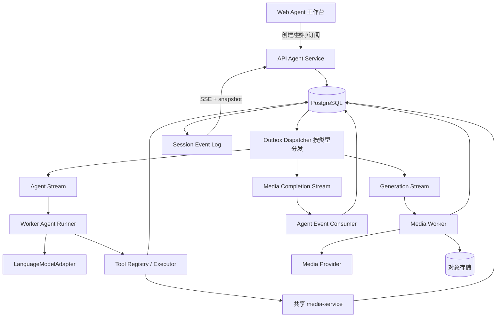

# MuseCanvas Agent Core V1 改造设计

- 日期：2026-11-17
- 状态：实现前详细设计稿
- 适用分支：`dev`
- 设计基线：当前工作区源码（HEAD `f660418c` 加现有未提交改动）
- 非目标：本次文档不修改业务代码、不执行数据库迁移、不启动服务、不承诺第三方 Provider 的生产兼容性

## 1. 文档目的

本文将 Agent Core V1 提议稿落到 MuseCanvas 当前仓库的真实模块、函数、表和接口上，解决以下问题：

1. 当前 `canvas-agent` 哪些能力可以直接复用。
2. 如何从“绑定 Canvas 的 HTTP 内联执行器”演进为“可持久恢复的单 Agent Runner”。
3. API、数据库、Worker、Provider、contracts 和 Web 工作台如何拆分。
4. 原有函数如何迁移、适配或移除，以及每项删除的前置门槛。
5. 哪些新依赖确实需要引入，哪些能力不应通过新依赖解决。
6. 如何分阶段实施、验证、灰度和回滚。

本文中的“现状”均附仓库路径和符号证据；“目标”是建议设计，不代表已经存在的代码。

## 2. 结论摘要

### 2.1 采用演进式改造，不另建媒体任务系统

当前仓库已经具备一条可复用的媒体闭环：

```text
API request
  -> createGenerationJob()
  -> generation_jobs + generation_job_inputs + outbox_events
  -> Outbox dispatch lease
  -> Redis generation stream
  -> Worker processJob()
  -> provider_runs lease/fencing
  -> Provider plugin submit/poll/cancel
  -> output_ingestions + object storage
  -> assets + generation_outputs
```

证据：

- `apps/api/src/modules/generations/create-job.ts:createGenerationJob`
- `apps/worker/src/queue/index.ts:dispatchOutbox, consume`
- `apps/worker/src/jobs/index.ts:processJob, persistJobSuccess, persistJobFailure`
- `packages/database/src/repositories/provider-runs.ts:updateProviderRunState, acquireWorkerLease`
- `packages/providers/src/core/types.ts:MediaProviderPlugin`

Agent Core 只负责“理解请求、选择工具、持久化执行计划、等待结果、继续推理”，不复制媒体提交、Provider 轮询、输出落盘或资产创建逻辑。

### 2.2 `canvas-agent` 是 V1 的迁移来源，不是最终边界

现有实现已经有：

- Canvas 绑定的 Session、Turn、Message、Pending Job、Terminal Event、Settings、Preparation。
- Turn lease、Pending submission lease、Edit preparation lease。
- SHA-256 请求摘要、确定性 tool identity、generation payload 校验和跨请求幂等。
- LLM tool call 主循环、工具参数校验、确认、画布 revision CAS、SSE 和断线恢复。

证据：

- `apps/api/src/modules/canvases/agent/loop.ts:runAgent`
- `apps/api/src/modules/canvases/agent/store.ts:AgentStore,PgAgentStore`
- `apps/api/src/modules/canvases/agent/tools.ts:agentTools,validateToolArguments,executeTool`
- `packages/database/src/repositories/canvas-agent.ts`
- `packages/database/migrations/0031_canvas_agent.sql`
- `packages/database/migrations/0032_canvas_agent_generation_v2.sql`
- `packages/database/migrations/0033_canvas_agent_preparations.sql`

但它仍有明确边界：

- Runner 绑定单次 POST-SSE 请求；页面关闭后没有独立的 Agent 后台消费者。
- SSE 没有 `id:` 和 `Last-Event-ID` 重放协议，事件只能通过 history/turn 重建。
- LLM chat 是完整响应后才发 `text_delta`，不是 token 级流式。
- 工具注册是 `tools.ts` 内的静态白名单，不是持久化、版本化、可授权的 Registry。
- 预算已有工具/任务/超时/自动续轮计数，但没有 token、金额和时间窗口预算。
- `canvas_agent_turns` 的状态只有 `running/completed/failed/canceled/expired`，不包含 `queued/waiting_tools/waiting_approval`。
- 目前没有通用 Session；Session 由 Canvas 唯一创建，`GET history` 甚至会创建 Session。

因此 V1 的核心改造是抽离运行时和工具执行边界，并让 Worker 负责唤醒/恢复；不是删除现有媒体 Worker，也不是直接把 `runAgent` 搬到一个新进程。

### 2.3 V1 推荐的最终分层

```text
packages/contracts
  Agent DTO / event envelope / endpoint constants / pure parsers
        |
packages/domain
  Turn state machine / budget rules / tool result rules / canonical hash
        |
packages/database
  Agent repositories / migrations / transactional outbox helpers
        |
packages/providers
  LanguageModelAdapter / MediaProviderPlugin (media execution kernel)
        |
packages/media-service (新增)
  非 HTTP 媒体创建命令 / 输入 attach / 编辑准备（通过 ports 接对象存储）
        |
apps/api
  Auth + resource APIs + Turn creation + control commands
        |
apps/worker
  Agent runner consumer + media consumer + recovery coordinator
        |
apps/web
  Agent workspace client island + TanStack Query + Zustand UI draft state
```

依赖方向保持单向：`contracts` 不依赖业务包；`domain` 不依赖 API/Worker；`database` 不依赖 `apps/*`；`providers` 不依赖 API；应用只消费 package。

## 3. 已核实现状

### 3.1 Agent 现状模块

| 当前文件 | 关键符号 | 当前职责 | V1 处置 |
|---|---|---|---|
| `apps/api/src/modules/canvases/agent/handlers.ts` | `createCanvasAgentHandlers`、`postCanvasAgentMessages`、`getCanvasAgentHistory`、`getCanvasAgentTurn`、`postCanvasAgentConfirm`、`postCanvasAgentApply` | HTTP guard、限流、POST-SSE、确认、apply | 保留兼容入口；改为调用通用 Agent API 适配层 |
| `apps/api/src/modules/canvases/agent/loop.ts` | `runAgent` | LLM 调用、tool call 处理、恢复、SSE 发送 | 拆为 `AgentRunner`；旧函数进入兼容适配层，最终删除 |
| `apps/api/src/modules/canvases/agent/store.ts` | `AgentStore`、`PgAgentStore`、`RunContext` | Canvas 专用持久化编排、配置、媒体和画布读取 | 拆成 `AgentRepository`、`TurnContextLoader`、`CanvasToolPorts`、`MediaToolPorts` |
| `apps/api/src/modules/canvases/agent/tools.ts` | `agentTools`、`validateToolArguments`、`executeTool` | 静态工具定义、参数校验、Canvas/media 工具执行 | 工具定义移入 Registry；执行适配器保留领域逻辑 |
| `apps/api/src/modules/canvases/agent/submit.ts` | `submitPending` | Pending claim 后调用 `createGenerationJob` | 改为 `MediaToolExecutor` 的事务外提交步骤 |
| `apps/api/src/modules/canvases/agent/sse.ts` | `agentStream` | HTTP ReadableStream、heartbeat、timeout、cleanup | 保留为同步兼容 transport；新增 SSE replay transport |
| `apps/api/src/modules/canvases/agent/history.ts` | `providerHistory`、`replayTurnOps`、public DTO 函数 | 模型上下文和 Canvas history 展示 | 通用 Item projection 保留；Canvas projection 变成适配器 |
| `apps/api/src/modules/canvases/agent/config.ts` | `runtimeConfig`、`validateLanguageConfig`、`modelConfigDigest` | 语言模型配置和安全错误 | 迁移为 `AgentModelResolver`；错误和 digest 进入 domain/shared |
| `packages/database/src/repositories/canvas-agent.ts` | session/turn/message/pending/terminal/apply 全部 SQL | Agent 持久化 | 拆成通用 Agent repository + Canvas repository；旧导出暂时 re-export |
| `packages/database/src/repositories/canvas-agent-preparations.ts` | preparation lease 和 edit artifact | 图片编辑 mask 两阶段准备 | 保留为 `EditPreparationRepository`，不放入通用 Runner |
| `apps/web/src/shared/hooks/useCanvasAgent.ts` | `useCanvasAgent` | Canvas history、SSE、确认、apply、恢复 | 复用 timeline/controller 逻辑，改为 `useAgentSession` + Canvas adapter |
| `apps/web/src/shared/lib/agent-stream.ts` | `streamAgentEvents`、`parseAgentEventStream` | POST-SSE 解析、断线错误 | 保留解析器；新增 durable event cursor 和重连流程 |
| `apps/web/src/shared/lib/agent-composer.ts` | `buildComposerUserRequest`、`buildJobEventRequest` | 结构化 Canvas 请求 | 改为通用 message builder；Canvas context 独立封装 |

### 3.2 现有数据库能力

当前 `0031` 至 `0033` 已提供：

- `canvas_agent_sessions`：每个 Canvas 唯一一个 Session、`next_seq`、running turn lease。
- `canvas_agent_turns`：请求摘要、lease、超时、终态和错误。
- `canvas_agent_messages`：user/assistant/tool 消息、递增 `seq`、tool calls、ops、usage。
- `canvas_agent_pending_jobs`：媒体提案、冻结 normalized request、确定性 idempotency key、提交 lease。
- `canvas_agent_terminal_events`：job event 去重和自动续轮约束。
- `canvas_agent_settings`：启用开关、语言模型、工具/任务/超时/自动续轮限制。
- `canvas_agent_preparations`：图片编辑 mask 的短期准备 lease、checksum、artifact 和 ready snapshot。

数据库触发器保证 turn/pending/preparation 的不可变字段不被意外更新。V1 采用新表承接新执行模型，旧表保持读取和旧引擎排空；同一执行请求只进入一种引擎，不对执行意图双写。

### 3.3 媒体 Provider 和 Worker 现状

媒体能力已覆盖提议稿的主要闭环：

- 图片：`packages/providers/src/plugins/openai-image/index.ts`、`seedream-image/index.ts`。
- 视频：`packages/providers/src/plugins/seedance-video/index.ts`、`veo-video/index.ts`。
- 图生视频：统一输入角色和模式 `image_to_video`，由 capabilities/input slots 校验。
- 图片编辑：现有 `prepareImageEdit` 生成/校验 source + alpha mask，并复用 `createGenerationJob`。
- Provider 任务支持 `submit`，可选 `poll`、`cancel`、`openOutput`；不应假设每个 Provider 都能立即取消。
- `provider_runs` 负责 submission uncertainty、remote id、opaque state、state revision、capacity 和 Worker lease。
- Worker 通过 Outbox dispatch lease、Redis Streams、heartbeat 和 `XAUTOCLAIM` 做至少一次交付。
- maintenance 会扫描过期 lease、due provider runs 和 cancel 请求。

这些是现有媒体执行能力；**媒体终态通知 Agent 的事件契约目前不存在**。当前 `persistJobSuccess`/`persistJobFailure` 主要更新 generation/job/asset 状态，现有 `dispatchOutbox` 也按 generation stream 消费。`media.job.updated`、`media.job.completed` 以及按事件类型路由到 Agent stream 是 V1 M3 新增工作，不能视为现状能力。

V1 的 Agent 工具只需创建标准 `generation_jobs`，不能直接调用 Provider plugin 或写 `provider_runs`。但当前 `createGenerationJob` 位于 API 且返回 `NextResponse`，不能由 Worker 直接调用；V1 必须先抽取共享的非 HTTP 媒体创建命令。

### 3.4 Web 现状

当前已有：

- `API_ENDPOINTS` 为端点唯一真源。
- `client-api.ts` 为浏览器同源 API 层，`server-api.ts` 为 RSC 服务端层。
- `useCanvasAgent`、`agent-stream`、`agent-timeline`、`agent-composer` 已形成 Canvas Agent Client 基础。
- Canvas 和 Agent 主要 hook 使用 TanStack Query；易失性草稿/视口适合 Zustand。
- `GenerateView` 当前直连 `clientApi.generations.create`，主要展示图像生成；视频和部分 Agent 入口仍有限制。
- 当前工作区尚无正式 Canvas/Agent 页面入口，需增加工作台路由和 Client Island。
- `AssetDto`、`GenerationJobDto` 等部分 DTO 仍定义在 `apps/web/src/shared/types`，跨端共享尚未完全收敛到 contracts。
- 当前 library detail 的历史读取存在“最近 100 条资产 fallback”，不能作为长期 Canvas 引用依据。

## 4. 目标架构

### 4.0 契约和运行边界

- `packages/domain` 只依赖 contracts，不承载数据库事务和应用 ports；V1 明确新增 `packages/media-service`，由 API 与 Worker 通过 `workspace:*` 依赖。该包编排 generation/edit 命令，不含 Next handler。
- `packages/contracts` 新增纯 TS DTO：`AgentSessionDTO`、`AgentTurnDTO`、`AgentItemDTO`、`AgentToolCallDTO`、`AgentApprovalDTO`、`AgentBudgetDTO`、`AgentEventEnvelope`、`AgentSessionSnapshotDTO` 及 create/resolve requests；增加状态 union、错误码与 event type 常量，不增加运行时 validator。
- `API_ENDPOINTS.agent` 提供 sessions collection/detail/messages/items/events、turn detail/cancel/steer、approval resolve 的路径 helper。每个 dynamic path 由 helper 生成，并同步 `apps/api/src/router/routes.ts` 和契约测试。
- JSON SSE 用 fetch stream，支持 `Last-Event-ID`/cursor；事件有 `schemaVersion` 和 session 单调 cursor。普通响应是 `{ success, data/error }`；SSE 建连前错误为 JSON，建连后为带 cursor 的 event frame。
- API 沿用现有 session middleware；所有读写、订阅、资源深链都以 owner scope 查询，跨 owner 与不存在统一 404。取消、审批和 Canvas apply 采用幂等 key/expected revision。
- Tool JSON Schema 只在 Worker Registry 校验；不把 validator 放入 contracts。Validator 必须声明支持的 schema dialect/关键字，遇未知关键字 fail closed。

### 4.1 运行时组件


#### API

API 只处理：

- actor/session 授权和资源 owner 校验。
- 创建 Session、追加用户消息、创建 Turn。
- 取消、steering、Approval resolve 等控制命令。
- 返回权威快照、Items、Turn 状态和 SSE 事件。
- 在事务中写入唤醒 Outbox，不等待模型或 Provider。

API 不处理：

- 长时间 LLM loop。
- 等待媒体 Provider。
- 在 HTTP 事务中执行外部网络请求。
- 直接向 Redis 发布没有数据库依据的 Agent 任务。

#### Agent Runner

Agent Runner 放入现有 `apps/worker`，V1 先作为独立 consumer 和现有 media consumer 共进程运行，使用独立 Redis Stream、consumer group 和并发上限。

Runner 每次只领取一个 `Turn`，流程为：

1. claim `turn_lease`，校验 fencing token。
2. 读取 config snapshot、Items、pending ToolCall、budget snapshot、steering revision。
3. 在模型调用前检查 cancel 和新 steering。
4. 调用 `LanguageModelAdapter`。
5. 校验模型返回的 tool call：工具存在、版本匹配、参数 schema、权限、资源归属和预算。
6. 在短事务中写 ToolCall/Item；提交媒体时在同一数据库事务内校验 Turn fencing/cancel/inputRevision、预留预算、创建 generation job、写 ToolJobLink 和唤醒 Outbox。外部 Provider 请求仍由媒体 Worker 在事务外执行。
7. 若工具返回 `pending`，Turn 转 `waiting_tools` 并释放 Runner lease。
8. 若需要用户确认，Turn 转 `waiting_approval` 并释放 Runner lease。
9. 若工具均同步完成，追加 tool result，继续下一轮。
10. 无工具调用时写 assistant Item 并进入 `completed`。
11. 所有写入均使用当前 fencing token 和条件更新，旧 Runner 不能覆盖新 owner。

#### Media Worker

保留当前 `processJob` 和 ProviderRun 状态机。V1 新增终态通知：只有 generation job 状态、全部资产及输出关系提交成功，才能在同一事务写 `media.job.completed`；最终失败和取消同样发终态事件。

- `generation_jobs` 终态。
- `assets`、`generation_outputs`。
- `outbox_events` 中的 `media.job.completed`；进度是合并后的 session event，V1 不增加每次 poll 都发的 command Outbox。

新增 Agent event consumer 只消费数据库已确认的 media event，并以 `ToolJobLink` 找到关联 ToolCall，再条件更新 ToolCall 和 Turn。它不重新判断 Provider 结果，也不创建资产。

#### Web Workspace

新增 `/agent/sessions/:id` 工作台，归入 `apps/web/src/app/(workspace)/(studio)/agent/sessions/[id]/page.tsx`，由 RSC 页面挂载 Agent 工作台 Client Island：

- Session/Canvas 选择。
- 消息时间线。
- ToolCall 状态卡片。
- 媒体任务进度和失败原因。
- Approval 卡片。
- 资产预览、下载和引用。
- 画布节点/边和版本冲突处理。
- 断线重连和权威同步。

Server Component 只做工作区登录守卫和初始资源读取；交互、SSE、TanStack Query 和 Zustand 全部留在 Client Island。

### 4.2 目标数据流

```text
POST /api/agent/sessions/:id/messages
  -> transaction:
       Item(user_message)
       Turn(queued)
       outbox(agent.turn.wake)
  -> response { sessionId, turnId, status: queued }

Agent Worker
  -> claim turn lease
  -> LLM call
  -> transaction A:
       Item(assistant/tool_call)
       ToolCall + model round checkpoint
  -> media tool transaction B (shared media-service command):
       fence Turn + check cancel/revision + reserve budget
       generation_jobs + inputs + ToolJobLink + generation outbox
       Turn(waiting_tools | waiting_approval | running)
  -> release turn lease

Media Worker
  -> provider_runs
  -> assets
  -> outbox(media.job.completed)

Agent event consumer
  -> ToolCall(result)
  -> Item(tool_result)
  -> if all dependencies terminal: Turn(queued) + outbox(agent.turn.wake)

Agent Worker
  -> append tool response
  -> continue LLM or complete Turn
```

### 4.3 Turn 状态机

```text
queued -> running
running -> waiting_tools
running -> waiting_approval
running -> completed
running -> failed
running -> cancelled
waiting_tools -> queued       (all linked jobs terminal)
waiting_approval -> queued    (approval resolved, all round gates resolved)
queued/running/waiting_* -> cancelled (explicit user cancellation, after local handoff)
```

约束：

- `completed`、`failed`、`cancelled` 为终态。
- cancel 使用 `cancelRequestedAt`，不是立即覆盖当前运行状态。
- 已提交的 media job 不因 Turn 取消而伪造为未执行；按 Provider 能力尝试取消，不能取消时继续记录真实结果和费用估算。Turn 可在本地控制收尾后进入 `cancelled`，媒体结果由独立 reconciler 排空，不重新激活 Turn。
- 拒绝或过期 Approval 使对应 ToolCall 产生 `APPROVAL_REJECTED/APPROVAL_EXPIRED` 工具结果；补齐同轮所有结果后恢复模型，由模型决定交付已有成果或继续允许的步骤，不自动等同于用户取消整轮。
- V1 每个 Session 最多一个非终态 Turn。
- `steering` 只追加 Item 并增加 `inputRevision`，不修改历史 user message。

## 5. 模块拆分

### 5.1 `packages/contracts`

新增建议：

```text
src/agent/
  definitions.ts       AgentDefinition DTO 和版本
  session.ts           Session/Turn/Item/ToolCall/Approval DTO
  tools.ts             ToolDefinition、ToolCall、ToolResult、JSON Schema 类型
  events.ts             AgentEventEnvelope 和事件 payload
  requests.ts           API request/response parser
```

导出：

- `TurnStatus`、`ToolCallStatus`、`ApprovalStatus`。
- `AgentItemType`：`user_message`、`assistant_message`、`tool_call`、`tool_result`、`approval`、`artifact_reference`、`system_event`。
- `ToolExecutionResult`：`completed`、`pending`、`failed`。
- `ToolDefinition`：name、description、schemaVersion、parameters、permission、cost policy、execution kind。
- `AgentEventEnvelope`：`eventId`、`sessionId`、`turnId`、`type`、`createdAt`、`itemSequence`、`entityRevision`、payload。
- `API_ENDPOINTS.agent` 动态 helper。

不在 contracts 引入数据库、Provider、Next.js 或 `pg`。

### 5.2 `packages/domain`

新增纯规则模块：

```text
src/agent/
  state-machine.ts     状态转移和终态判断
  budgets.ts           计数/时间/token/estimated-cost 规则
  tool-contract.ts     tool call/result 结构和依赖规则
  identity.ts          canonical JSON、arguments hash、idempotency key
  context.ts           context item 选择和摘要范围
  cancellation.ts      cancel/late result 规则
```

原因：这些规则不应继续藏在 `apps/api/src/modules/canvases/agent/loop.ts` 或 SQL 字符串中，也不应由 Worker 和 API 各自复制。

### 5.3 `packages/database`

建议新增仓储：

```text
src/repositories/agent-definitions.ts
src/repositories/agent-sessions.ts
src/repositories/agent-turns.ts
src/repositories/agent-items.ts
src/repositories/agent-tool-calls.ts
src/repositories/agent-approvals.ts
src/repositories/agent-events.ts
src/repositories/agent-recovery.ts
```

公共事务方法：

- `createSession`
- `appendUserItemAndQueueTurn`
- `claimTurnLease`
- `renewTurnLease`
- `releaseTurnLease`
- `appendToolCall`
- `recordToolResult`
- `transitionTurn`
- `requestTurnCancel`
- `appendSteeringItem`
- `claimApproval`
- `resolveApproval`
- `claimAgentEvent`
- `queueTurnIfDependenciesTerminal`
- `readSessionSnapshot`
- `readItemsAfter`

所有公开仓储方法均要求 owner/session scope；不得提供无 owner 参数的通用读取函数。

### 5.4 `packages/providers`

保留媒体 Provider kernel，新增语言模型抽象的最小扩展：

```ts
interface LanguageModelAdapter {
  chat(input: LanguageModelChatInput): Promise<LanguageModelChatResult>
  capabilities(input: LanguageModelConfig): LanguageModelCapabilities
}
```

V1 不引入 OpenAI Agents SDK，不把第三方 Agent runtime 的对象模型传入数据库。当前 `callLanguageModelChat` 可先作为 adapter 实现；模型私有 reasoning 不落 Item。

媒体侧只扩展必要的 capability 元数据：

```ts
interface MediaModelCapabilities {
  modes: GenerationMode[]
  inputSlots: InputSlot[]
  supportsPoll: boolean
  supportsCancel: boolean
  supportsVisionReference?: boolean
  pricing?: PricingDescriptor
}
```

`supportsPoll`/`supportsCancel` 必须是已验证的 Provider 行为声明；缺失时按 false/unknown 处理，不能从插件名推断。

#### 共享媒体创建命令：新增 `packages/media-service`

当前 `apps/api/src/modules/generations/create-job.ts:createGenerationJob` 返回 `NextResponse`，依赖 API 的 `Actor`、DTO signer、runtime settings 和 generation-upload helpers。`prepareImageEdit` 也返回 HTTP 错误，并通过 `defaultImageEditPorts` 绑定 API storage。两者都不能直接搬进 Worker。

V1 新增一个有实际跨 app 复用需求的服务端包；domain 继续只承载纯规则，暂不新增 `agent-runtime` 或 `agent-tools` package：

```text
packages/media-service/
  package.json                  @musecanvas/media-service
  src/index.ts                  typed public exports
  src/commands/create-job.ts    prepareGeneration / createGenerationInTransaction
  src/commands/cancel-job.ts    requestGenerationCancellation
  src/inputs/attach.ts          generation input persistence/ownership
  src/image-edit/prepare.ts     prepareImageEditCommand
  src/image-edit/input-rows.ts  input reservation and immutable staging
  src/model-snapshot.ts        safe model/revision/capability loading
  src/ports.ts                 storage + runtime settings ports
  src/errors.ts                typed error, no NextResponse
```

包依赖 `contracts`、`domain`、`database`、`providers`（均 `workspace:*`）及直接使用的类型依赖；API 与 Worker 新增 `@musecanvas/media-service: workspace:*`。对象存储 driver 由应用注入，不在共享包创建 Next handler、API signer、Redis client 或长期服务。

- API 原 `createGenerationJob` 保留签名作为 HTTP adapter：解析 body 后调用共享命令，将纯结果序列化为现有 `202` job DTO，将领域错误转成 `fail`。
- Worker `MediaToolExecutor` 调用相同命令，直接取得 `jobId`，不反序列化 HTTP Response。
- `prepareImageEditCommand` 返回 typed data/error，API `prepareImageEdit` 暂保留兼容包装；Worker 注入自己的 storage/runtime ports。
- `prepareGeneration` 可做事务外读取与纯规范化；`createGenerationInTransaction(client, command)` 必须在实际事务内重新校验模型快照与输入归属，并完成 job、inputs 和 outbox 写入。
- Agent 工具的调用方在同一事务里完成 fencing、budget reserve 和 ToolJobLink；手动生成调用方拥有自己的事务。共享命令不得隐式 nested BEGIN，也不得持锁做网络 I/O。
- prompt preprocessing/optimization 在原媒体链路继续保留，计入执行截止时间和成本估算；Agent 工具不能另开第二条优化链路。

### 5.5 `apps/api/src/modules/agent`

目标目录：

```text
agent/
  routes.ts              新 API handler factory
  service.ts             创建 Session/Turn/控制命令
  authorization.ts       owner、tool permission、canvas/resource scope
  events.ts              owner-scoped SSE projection / replay
  model-policy.ts        definition/config snapshot admission validation
  legacy-canvas-adapter.ts
```

API service 不执行 Runner loop。`apps/api/src/modules/canvases/agent` 在 M1-M4 作为旧入口适配层保留。

### 5.6 `apps/worker/src/agent`

新增：

```text
agent/
  consumer.ts            Agent wake stream consumer
  runner.ts              单 Turn 执行器
  lease.ts               Turn lease renew/fence
  recovery.ts            过期 lease/悬挂状态协调器
  event-consumer.ts      media event -> ToolCall/Turn
  context.ts              模型上下文构造
  budget.ts               reserve/settle budget
  telemetry.ts            span/log/metrics
  tools/registry.ts       versioned schemas, allowlist, validation
  tools/executor.ts       validation/permission/budget dispatch
  tools/media.ts          shared media-service adapter
  tools/assets.ts         owner-scoped search/get_asset
  tools/canvas.ts         node operation/revision adapter
```

`apps/worker/src/index.ts` 新增独立启动 cadence，但 M1 可与 media consumer 共进程。Agent consumer 不应复用 `GENERATION_STREAM` 的 consumer group；使用独立 stream/group 和并发配置。

### 5.7 `apps/web`

建议目录：

```text
src/features/agent/
  components/agent-workspace.tsx
  components/agent-timeline.tsx
  components/tool-call-card.tsx
  components/approval-card.tsx
  components/artifact-strip.tsx
  components/agent-composer.tsx
  hooks/use-agent-session.ts
  hooks/use-agent-events.ts
  lib/agent-reconciliation.ts
  stores/agent-ui-store.ts

src/features/canvas/
  components/canvas-workspace.tsx
  components/canvas-node.tsx
  components/canvas-toolbar.tsx
  hooks/use-canvas-draft.ts
```

已有 `useCanvasAgent`、`agent-timeline`、`agent-stream` 先复用逻辑，再拆文件；不得先建立另一套 timeline 和 API client。

## 6. 数据库调整

### 6.1 新表建议

建议新增两个递增 migration，例如 `0041_agent_core.sql` 和 `0042_agent_runtime_ledgers.sql`（版本以合并时为准），分别建立核心表与预算账本/恢复约束。概念表如下：

#### `agent_definitions`

```text
id uuid primary key
owner_id uuid null references users(id)
name text not null
version integer not null
model_policy jsonb not null
instructions text not null
tool_allowlist jsonb not null
budget_policy jsonb not null
status text not null
created_at/updated_at timestamptz
unique(owner_id, name, version)
```

`owner_id` 允许 NULL 时，普通 `UNIQUE(owner_id, name, version)` 无法阻止多份同名系统 definition；若 V1 需要单一系统/租户级 definition，必须额外增加 `UNIQUE INDEX ... WHERE owner_id IS NULL`，或改用非空 `scope_id`。V1 可以只有一个系统/租户级 definition，但唯一性必须由上述约束真正保证。

#### `agent_sessions`

```text
id uuid primary key
owner_id uuid not null references users(id)
agent_definition_id uuid not null references agent_definitions(id)
definition_version integer not null
default_canvas_id uuid null references canvas_documents(id)
active_turn_id uuid null
input_revision integer not null default 0
created_at/updated_at timestamptz
```

`default_canvas_id` 是默认上下文，不等于所有资源归属关系。Canvas 节点引用仍由 scene 中的 `assetId/jobId` 表达。

#### `agent_turns`

```text
id uuid primary key
session_id uuid not null references agent_sessions(id)
client_idempotency_key text not null
status text not null
config_snapshot jsonb not null
budget_snapshot jsonb not null
engine_version text not null
request_digest text not null
revision bigint not null default 1
input_revision bigint not null
fencing_token bigint not null default 0
lease_owner text
lease_until timestamptz
cancel_requested_at timestamptz
terminal_at timestamptz
error jsonb
created_at/updated_at timestamptz
unique(session_id, client_idempotency_key)
```

`config_snapshot` 和 `budget_snapshot` 必须在 Turn 创建时冻结；AgentDefinition 后续修改不影响历史解释。

#### `agent_items`

```text
id uuid primary key
session_id uuid not null references agent_sessions(id)
turn_id uuid null references agent_turns(id)
sequence bigint not null
item_type text not null
payload jsonb not null
content_digest text not null
created_at timestamptz not null
unique(session_id, sequence)
unique(session_id, id)
```

大型工具输出不直接存完整二进制或长文本，改存 `artifact_reference`、摘要和 item sequence 范围。

#### `agent_tool_calls`

```text
tool_call_id uuid primary key
turn_id uuid not null references agent_turns(id)
provider_call_id text not null
tool_name text not null
tool_schema_version integer not null
arguments jsonb not null
arguments_hash text not null
status text not null
idempotency_key text not null
result jsonb
error jsonb
created_at/updated_at
unique(turn_id, provider_call_id)
unique(turn_id, idempotency_key)
```

#### `agent_tool_job_links`

```text
tool_call_id uuid not null references agent_tool_calls(tool_call_id)
media_job_id uuid not null references generation_jobs(id)
position integer not null
dependency_role text not null
created_at timestamptz not null
primary key(tool_call_id, media_job_id)
```

一个 ToolCall 可以关联多个 media job；只有所有依赖进入终态后才可补齐 tool result。

#### `agent_approvals`

```text
id uuid primary key
turn_id uuid not null references agent_turns(id)
tool_call_id uuid not null references agent_tool_calls(tool_call_id)
arguments_hash text not null
estimated_cost jsonb
status text not null
expires_at timestamptz
resolved_by uuid references users(id)
resolved_at timestamptz
unique(tool_call_id, arguments_hash)
```

#### 共用 `outbox_events`（不新增同名 Agent 专用 Outbox）

复用当前 `outbox_events`；新增 `event_type` 路由，沿用 `dedupe_key`、dispatch lease 和 payload version。先完成 dispatcher 分流再打开任何新事件 producer（M1 阻断项），因为当前 dispatcher 不读取 `event_type`，会把所有记录的 aggregate ID 当作 job ID。统一事件命名：

- `generation.requested` / `generation.retry` / `generation.retry.manual` / `generation.cancel.requested` / `provider_run.poll` / `provider_run.cancel`：媒体执行 command -> generation stream（保留现有真实类型）。
- `agent.turn.wake`：Agent 执行 command -> agent stream。
- `media.job.completed`：媒体终态 fact -> Agent media-event stream（M3 新增）。
- 前端展示事件 `item.created`、`tool.updated`、`approval.required`、`turn.updated`：写入下一节的 `agent_session_events`，不作为 generation command。

Outbox dispatcher 按 allowlist 路由并保留原 `eventId`；未知类型隔离告警，不标 dispatched，不误送任何 stream。每条 Outbox 只有一个目标 stream，共用数据库 claim/lease；各 stream 使用独立消费组、阻塞 Redis connection、并发和 retention。将当前 `blockingRedis` 单例参数化，避免 Agent 阻塞读占用媒体消费者连接。

#### `agent_session_events`：SSE 有限重放

```text
id uuid primary key
session_id uuid not null
turn_id uuid null
cursor bigint not null
entity_revision bigint null
item_sequence bigint null
event_type text not null
payload jsonb not null
created_at timestamptz not null
unique(session_id, cursor)
```

它是用户可见事件日志，和队列 Outbox 分工不同。实体变更事务同时写该表；SSE 可以轮询日志，Redis notification 只作低延迟唤醒。Outbox 清理不删 SSE 所需的近期事件，SSE 事件清理不影响 ToolCall/Item。`eventId` 是去重标识，顺序由 `cursor` 决定，UUID 不用于大小排序。

### 6.2 与旧表的迁移策略

1. **先增表**：不修改 `0031`-`0033` 历史结构。
2. **双入口、单所有者**：新请求 admission 时持久化 `engine_version` 和 client request 映射；同一幂等键即使在 feature flag 翻转后也返回原引擎/Turn。旧请求继续写旧表并由旧逻辑收尾，新请求只写新表。可双写审计/映射，禁止双写会触发执行的意图。
3. **读取优先级**：新 Session/Turn 先读新表；无映射的旧数据返回 `legacy: true`。
4. **媒体关联**：新 ToolCall 通过 `agent_tool_job_links` 关联现有 `generation_jobs`；旧 `canvas_agent_pending_jobs.job_id` 只做 legacy 映射。
5. **事件补偿**：迁移窗口启用 coordinator，扫描“generation job 已终态但 ToolCall 未更新”和“waiting 条件已满足但 Turn 未 queued”。
6. **切换开关**：按 actor/租户/百分比灰度启用新入口。
7. **删除旧表**：至少完成一个完整 retention 周期、无 active legacy turn、无 pending/submitting legacy job、回滚演练通过后再另开 migration 删除。

### 6.3 关键索引和约束

- 所有 owner scope：`(owner_id, id)`、`(owner_id, created_at desc)`。
- Session 活动 Turn：部分唯一索引，保证一个 Session 最多一个非终态 Turn。
- `agent_items(session_id, sequence)` 唯一且递增由数据库分配。
- `agent_tool_calls(turn_id, provider_call_id)` 唯一。
- `agent_tool_job_links(media_job_id)` 普通索引，支持媒体终态反查。
- `outbox_events(event_type, dispatched_at, created_at)` 与现有 dispatch lease 配合。
- 所有 JSON payload 写入前做大小限制；数据库约束只作为最后一道防线。
- owner FK、Canvas FK、Asset/job 归属在 SQL 查询中同时校验，不能只依赖 API 先验检查。

## 7. Tool Registry 和工具拆分

### 7.1 Registry 接口

建议定义：

```ts
interface AgentToolDefinition {
  name: string
  description: string
  schemaVersion: number
  parameters: JsonSchema
  permissions: string[]
  execution: 'sync' | 'media_async' | 'canvas_mutation'
  requiresApproval: ApprovalPolicy
  budget: ToolBudgetPolicy
  execute(context: ToolContext, args: JsonObject): Promise<ToolExecutionResult>
}
```

Registry 装配时完成：

- 工具名和 schemaVersion 唯一校验。
- AgentDefinition allowlist 校验。
- capability policy 校验。
- 权限范围声明。
- 运行时 handler 绑定。

模型返回的 schema 只能作为请求输入，不能决定服务器是否注册工具。

### 7.2 V1 工具清单

| 工具 | 执行方式 | 复用现状 | 主要新增校验 |
|---|---|---|---|
| `list_models` | sync | `PgAgentStore.models`、capabilities DTO | task type、enabled、declared capabilities、价格估计 |
| `generate_image` | media_async | `normalizeSubmissionRequest` + `createGenerationJob` | owner input、count、budget reservation |
| `edit_image` | media_async | `prepareImageEdit`、`canvas-agent-preparations` | source checksum、mask、inpaint mode |
| `generate_video` | media_async | video input slots + `createGenerationJob` | image reference ready、duration、provider mode |
| `search_assets` | sync | library query 可复用部分 | owner scope、分页、结果数量 |
| `get_asset` | sync | library detail 新增接口 | owner、signed URL TTL、允许模型访问的引用 |
| `get_canvas` | sync | `canvasSummary`、Canvas repository | 局部范围、节点/边大小上限 |
| `apply_canvas_operations` | canvas_mutation | `applyCanvasAgentTurnScene`、Canvas revision CAS | expectedVersion、operation allowlist、冲突重读 |

V1 不包含：通用脚本、任意 HTTP、SQL、文件系统、shell、浏览器自动化、视频剪辑合成。

### 7.3 媒体工具的提交契约

`ToolExecutionResult.pending` 只表示“媒体任务已持久化或已受理”，不表示作品已生成完成：

```ts
{ kind: 'pending', jobIds: ['...'] }
```

最终 Tool result 必须由 Agent event consumer 根据数据库权威状态生成：

- succeeded：`jobIds`、`assetIds`、媒体元数据。
- failed：错误码、是否可重试、已产生的费用/估算。
- canceled：取消请求结果和实际 Provider 终态。
- submission_unknown：ToolCall 仍为非终态 `waiting_external`，UI 显示需恢复/核对。受理不确定不能转成功，不能自动重新提交；达到协调截止时间后记录明确失败/人工恢复原因。

## 8. API 设计

### 8.1 新 API

建议在 `packages/contracts/src/endpoints.ts` 增加：

```text
POST /api/agent/sessions
GET  /api/agent/sessions/:id
POST /api/agent/sessions/:id/messages
GET  /api/agent/sessions/:id/items?after=...
GET  /api/agent/sessions/:id/events?afterEventId=...
GET  /api/agent/turns/:id
POST /api/agent/turns/:id/cancel
POST /api/agent/turns/:id/steer
POST /api/agent/approvals/:id/resolve
```

除 SSE 成功响应使用 `text/event-stream` 外，普通接口返回统一 `{ success, data/error }` 信封；流建立前的错误也用 JSON。所有读写、订阅及资源深链都校验 Session owner。

### 8.2 幂等

- Session 创建接受 `Idempotency-Key`，同 owner、同 key、不同规范化 body 返回 `409 IDEMPOTENCY_CONFLICT`。
- Message 创建使用客户端 message ID + canonical request digest。
- ToolCall 使用 `(turnId, providerCallId)` 和服务端生成的 `idempotencyKey`。
- Approval resolve 使用 Approval ID + expected arguments hash；重复同意返回同一结果，参数 hash 改变返回 conflict。
- API 只返回业务 ID 和当前状态，不同步等待 Runner。

### 8.3 SSE 恢复

保留现有 POST-SSE 作为兼容交互流，但新工作台使用：

1. `GET /events?afterEventId=...` 建立订阅。
2. 客户端先缓存事件，再读取 Session snapshot 和 Items 增量。
3. 按 event ID、item sequence、entity revision 合并。
4. 事件过期或游标无效时返回 `RESYNC_REQUIRED`，客户端重新读权威快照。
5. 事件 payload 不包含密钥、未脱敏 Provider URL 或不可控临时签名链接。

事件先持久化到 `agent_session_events` 再对外发布；队列 wake 另写共用 Outbox。API 断流或 Redis 通知丢失时，从事件日志和权威实体恢复，不自动重发创建请求。

## 9. 旧函数、方法和模块的迁移/移除清单

“移除”分为：立即禁止新增调用、迁移后删除、暂不删除三种，避免删除兼容代码造成重复任务或历史不可读。

### 9.1 迁移到新 Core

| 旧符号 | 新归属 | 处理方式 |
|---|---|---|
| `runAgent` | `apps/worker/src/agent/runner.ts:runTurn` | 先复制行为并加 adapter；新入口稳定后删除旧实现 |
| `AgentStore.start` | `AgentSessionService.createOrReplayTurn` | 保留 `LegacyCanvasAgentAdapter.start` 调用新 service |
| `PgAgentStore.recordRound/result/finish/release` | Agent repositories + runner | 删除 API 进程持有长 loop 后再删 |
| `agentTools` | `ToolRegistry` definitions | 逐工具迁移；`tools.ts` 只保留 re-export 过渡 |
| `validateToolArguments` | `ToolSchemaValidator` | 先复用现有纯校验；JSON Schema 标准化后统一入口 |
| `executeTool` | 各 `ToolExecutor` | `canvas`、`media`、`approval` 分开，禁止继续增长单函数 |
| `submitPending` | `MediaToolExecutor.submit` | 继续调用 `packages/media-service`，保留 frozen payload 校验 |
| `runtimeConfig` | `AgentModelResolver.resolveSnapshot` | 返回不可变 config snapshot，不暴露 credential |
| `providerHistory` | `ContextAssembler` | 只负责近期 Items、摘要和 tool result 引用 |
| `agentStream` | `LegacyPostSseTransport` | 新工作台使用 event replay；旧 Canvas 保持兼容 |
| `useCanvasAgent` | `useAgentSession` + Canvas adapter | 先保留 hook API，内部改调用新 endpoints |

### 9.2 迁移后删除候选

只有同时满足“无生产调用、历史读取有兼容、灰度回滚窗口结束、相关测试已替换”才可删除：

- `apps/api/src/modules/canvases/agent/loop.ts:runAgent`
- `apps/api/src/modules/canvases/agent/submit.ts:submitPending`
- `apps/api/src/modules/canvases/agent/tools.ts` 中 Canvas 和 media 混合的 `executeTool`
- `apps/api/src/modules/canvases/agent/handlers.ts` 中旧 `messages/confirm/apply` 直接执行路径
- `PgAgentStore` 中只服务旧表的 `recordRound/result/finish` 专用分支
- `canvas_agent_pending_jobs` 的新写入能力（读取和 legacy mapping 仍保留一个 retention 周期）
- `canvas_agent_terminal_events` 的自动续轮实现（由新 Agent event consumer 接管后）
- Web 侧最近 100 条资产详情 fallback；必须先上线 owner-scoped `GET /api/library/:id`。

### 9.3 本阶段明确不删除

- `createGenerationJob`：API 兼容 wrapper；手动生成、图片编辑、Agent 都复用 `packages/media-service` 的非 HTTP 创建命令，是媒体创建唯一真源。
- `apps/worker/src/jobs/index.ts` 的 ProviderRun 生命周期。
- `apps/worker/src/jobs/lease.ts` 的 provider fencing。
- `apps/worker/src/queue/index.ts` 的 generation Outbox/Redis consumer。
- `prepareImageEdit` 和 `canvas-agent-preparations`：图片编辑的 source/mask 安全边界。
- `Canvas` revision CAS 和 `applyCanvasAgentTurnScene`：新 Canvas tool 仍需同一并发语义。
- `client-api.ts`、`server-api.ts` 双端隔离。
- direct `/api/generations`、`/api/images/edit`：除非确认所有外部消费者和手动入口都迁移，V1 不强制 Agent-only。

## 10. 新依赖决策

### 10.1 V1 必须新增

| 依赖 | 归属 | 是否建议 | 原因 |
|---|---|---|---|
| `@musecanvas/media-service` | 新增 workspace 包；API/Worker 消费 | 必须 | 统一非 HTTP 媒体创建与编辑准备，消除跨 app 源码引用 |
| 第三方运行时依赖 | 全仓 | 默认无强制新增 | PostgreSQL、Redis Streams、Next、TanStack Query、现有 Provider/OTel 已覆盖核心需求 |
| `@musecanvas/contracts` workspace exports | contracts/API/Web | 必须调整代码，不是第三方依赖 | 新 DTO、事件、端点必须共享 |
| `@musecanvas/database` exports | API/Worker | 必须调整导出 | 新 repository 需通过 workspace 包边界访问 |

### 10.2 可选依赖，默认不引入

| 依赖 | 结论 | 理由 |
|---|---|---|
| OpenAI Agents SDK | 不引入 | 设计要求 MuseCanvas 自身协议；第三方资源模型和生命周期会侵入持久化边界 |
| LangChain/LangGraph | 不引入 | V1 单 Agent、工具数量有限，增加抽象和运行时状态映射成本 |
| BullMQ/Temporal | 不引入 | 当前 Outbox + Redis Streams + PostgreSQL lease 已覆盖至少一次唤醒和恢复；先用真实指标决定是否需要新调度系统 |
| React Flow/XYFlow | 待评审 | 若需要成熟节点交互可单独引入；不是 Agent Core 必需依赖，先定义 Canvas UI 契约和性能基线 |
| `ajv` + `ajv-formats` | 有条件引入 Worker | 需要完整 JSON Schema 时在 `apps/worker` 直接声明，使用锁定版本与初始化编译；UUID format 需 formats 支持。V1 若先复用现有 validator，必须声明只支持其实际覆盖的 Schema 子集，新增不支持的关键字在 Registry 初始化时拒绝。不在 contracts 引入校验库 |
| EventSource polyfill | 不引入 | 当前使用 fetch ReadableStream POST-SSE；V1 事件订阅可继续使用 fetch stream，避免浏览器 EventSource 的方法/认证限制 |

如最终决定引入 `ajv` 或画布引擎，必须同步对应 `package.json`、根 `pnpm-lock.yaml`、bundle 体积评估、许可证检查和测试；不得在子包生成 `package-lock.json`。

## 11. 成本、预算和权限

### 11.1 预算模型

当前只有 settings 的工具/任务/超时/自动续轮限制，不能称为费用预算。V1 增加：

```text
maxModelCalls
maxToolCalls
maxMediaJobs
maxMediaOutputs
maxInputTokens
maxOutputTokens
maxEstimatedCost
deadlineAt
maxConcurrentMediaJobs
```

预算生命周期：

1. Turn 创建时保存 policy snapshot。
2. 每个模型调用前原子预留 token/call 额度。
3. 每个媒体工具提交前原子预留 job/output/estimated cost。
4. 任务终态后结算实际 usage；Provider 无可靠价格时记录 estimate + pricing source。
5. 失败按 Provider 计费语义释放或记账。
6. 任何 reserve 不得只在 Redis 中完成，数据库是权威依据。

当前仓库在 `0024_remove_billing_credits.sql` 已删除旧 credits/billing 表，因此 V1 不得复活旧 credits 字段作为新预算设计。新增预算应是 Agent execution budget，后续再与计费域对接。

### 11.2 权限

- Session、Turn、Item、ToolCall、Approval、Asset、Job 均 owner scoped。
- Tool allowlist 是服务端定义，不接受模型自行扩展。
- `assetId` 必须解析为当前 owner 的 active asset；输入引用有效期、媒体类型和 Provider capability 必须服务端校验。
- Canvas 操作必须带 expected revision；冲突时重新读取相关节点，不覆盖用户的新版本。
- `get_asset` 返回给模型的是受控内容引用或 metadata；不把永久签名 URL 写入 Item。
- 日志统一带 `sessionId`、`turnId`、`toolCallId`、`jobId`、`providerRequestId`，不记录 credential、完整 signed URL 或未经脱敏的 Provider body。

## 12. 实施里程碑和 DAG

### M0：现状核实和契约冻结

动作：

- 冻结新 Agent DTO、event envelope、状态枚举、错误码和 endpoints。
- 统计现有 Canvas Agent 调用方和 direct generation 调用方。
- 用代码位置记录 Provider 的 poll/cancel/vision/pricing 能力。
- 明确 Session 是否允许无 Canvas。

验收：

- 所有现状结论有源码/SQL路径。
- contracts 编译、端点测试通过。
- 设计评审确认“费用预算是否属于 V1 硬门槛”。

### M1：通用持久化和 API 入队

动作：

- 抽取 `packages/media-service`，先让手动 generation/edit 和旧 Agent 经过兼容包装调用它，保持原 HTTP 行为。
- 先部署按 `event_type` 分流的 Outbox dispatcher，再新增 Agent wake producer。
- 新增 Agent 表、repository、Outbox event types。
- 实现 Session/Turn/Item 创建、幂等和 owner scope。
- API 创建 Turn 只返回 queued，不调用 LLM。
- 实现 `GET snapshot/items/turn`。

验收：

- 重复 message key 只创建一个 Turn。
- 不同 body 同 key 返回 conflict。
- API 重启后 queued Turn 仍可扫描。
- 旧 Canvas endpoint 行为未改变。

### M2：Runner 和工具 Registry

动作：

- 在 Worker 增加 agent stream/group。
- 抽出 LanguageModelAdapter、AgentRunner、Turn lease/fencing。
- 迁移 `get_canvas`、`list_models`、`search_assets`、`get_asset`。
- 将旧 `runAgent` 接入 adapter 作为对照实现。

验收：

- Runner 崩溃后 lease 过期可接管。
- 旧 Runner 不能覆盖新 Runner 写入。
- Tool 参数、schema version、权限和预算失败均可审计。
- LLM 私有 reasoning 不落 Item。

### M3：媒体闭环

动作：

- `generate_image`、`edit_image`、`generate_video` 接入 Registry。
- 复用 `packages/media-service` 的非 HTTP 创建/编辑命令、generation inputs 和现有 Outbox；API 的 `createGenerationJob` 保持 HTTP adapter。
- 新增 `agent_tool_job_links`。
- Media event consumer 处理 succeeded/failed/canceled/unknown。

验收：

- 生图完成后自动恢复 Turn，并将 asset 作为下一轮 video 输入。
- 重复 event 不重复追加 result、不重复创建 job。
- `createGenerationJob` 同 key 同 payload replay，不同 payload conflict。
- Provider unknown submission 不自动盲重提。

### M4：工作台和恢复

动作：

- 新增 workspace/Agent 页面。
- 复用 `agent-timeline` 和 `agent-stream`，增加 event cursor、快照合并和 resync。
- 增加 ToolCall、媒体进度、资产和 Approval UI。
- 增加稳定 asset detail API，移除最近 100 条 fallback。

验收：

- 页面刷新、SSE 断开、API 重启后时间线和交付资产一致。
- 移动端和桌面端无状态卡片重叠。
- 画布 revision 冲突显示明确，不能静默覆盖。

### M5：用户控制和灰度

动作：

- steering、cancel、approval resolve、deadline 和预算结算。
- 新旧入口按 feature flag 灰度。
- 增加 coordinator：过期 lease、悬挂 ToolCall、终态媒体任务、outbox 积压。
- 完成旧入口适配和回滚演练。

验收：

- cancel 后不再提交新媒体任务。
- 已提交但无法取消的任务保留真实结果。
- approval resolve 幂等。
- 新旧入口不重复计费、不重复 job、不丢 asset。
- 关闭新入口后，新引擎已受理任务仍能排空。

DAG：

```text
M0
 |
 +--> M1 contracts/database/API enqueue
         |
         +--> M2 Runner/Registry
                 |
                 +--> M3 media link/event recovery
                         |
                         +--> M4 workspace/reconnect
                                 |
                                 +--> M5 controls/gray rollout
```

M3 的 Provider 适配可与 M4 的纯 UI 时间线工作并行，但必须先冻结 M1 contracts。

## 13. 测试和可观测性

### 13.1 必测场景

#### 持久化和并发

- 同一 Session 同时创建两个 Turn。
- 同一 idempotency key 重复提交和不同 body 冲突。
- Worker 提交 ToolCall 后进程崩溃。
- lease 到期前后两个 Runner 竞争。
- 旧 fencing token 尝试写状态。
- API 重启、Worker 重启、Redis stream message 重投。
- Item sequence 并发分配无重复。

#### 媒体和事件

- image -> video 依赖链。
- 多个 ToolJobLink 全部完成后才唤醒 Turn。
- 重复 media event、乱序 event、过期 event。
- Provider accepted 后 API/Worker 崩溃。
- submission unknown 不重复计费。
- asset 保存失败后的 ingestion 恢复。
- cancel 与完成事件竞态。
- Provider 不支持 cancel 的真实语义。

#### 安全和产品

- 跨 owner Session/Asset/Job/Canvas 访问。
- tool schema 注入、额外字段、超深 JSON、超大输出。
- 模型返回未注册工具。
- 模型仅文本能力时不声称完成视觉评价。
- Canvas revision conflict 和重复 apply。
- Approval 参数 hash 变化和重复确认。

### 13.2 现有测试可复用

- Agent API：`apps/api/src/modules/canvases/agent/canvas-agent.test.ts`
- Agent store：`apps/api/src/modules/canvases/agent/store.test.ts`
- Agent persistence：`apps/api/src/modules/canvases/agent/persistence.test.ts`
- Database Agent：`packages/database/src/canvas-agent.test.ts`
- Agent generation PG：`tests/integration/canvas-agent-tools-pg.test.ts`、`canvas-agent-generation-v2.test.ts`
- Media lifecycle：`apps/worker/src/jobs/index.test.ts`、`lease.test.ts`、`provider-state.test.ts`；`lifecycle.ts` 的相关行为由 jobs 测试覆盖，当前没有独立 `lifecycle.test.ts`。
- Queue/outbox：`apps/worker/src/queue/index.test.ts`
- Provider：各 image/video plugin test
- Web timeline：`apps/web/src/shared/lib/agent-timeline.test.mjs`
- Web scope isolation：`apps/web/src/shared/hooks/useCanvasAgent.scope-regression.test.mjs`

注意：根 `pnpm test` 的 recursive glob 不自然收集全部 `tests/integration` 和 `tests/e2e`；集成测试需显式命令和隔离数据库/Redis。调研阶段未运行这些测试。

### 13.3 指标

至少记录：

- `agent.turn.queue_wait_ms`
- `agent.turn.running_ms`
- `agent.model.call_ms`
- `agent.tool.duration_ms`
- `agent.turn.waiting_tools_ms`
- `agent.turn.recovery_count`
- `agent.turn.lease_expired_total`
- `agent.event.duplicate_total`
- `agent.outbox.pending`
- `agent.budget.reserve_conflict_total`
- `agent.budget.estimated_vs_actual`
- `agent.media.unknown_submission_total`
- `agent.sse.reconnect_total`
- `agent.sse.resync_total`

日志字段贯穿 session/turn/tool/job/provider request；所有敏感字段使用 allowlist，而不是事后删除。

## 14. 回滚策略

### 14.1 代码回滚

- feature flag 只停止新引擎 admission，保留新 Agent consumer 和 coordinator，继续处理其已受理 Turn 的恢复、审批、工具完成和收尾；旧 Canvas 请求继续走旧入口。
- 任何 Turn 固定 `engine_version`，不由 legacy loop 接管新 Core 状态。紧急停止付费执行时设置 `pause_new_tools`，记录可见暂停原因；仍允许结算与读取。
- 已创建的 `generation_jobs` 不回滚、不删除，继续由现有 Media Worker 排空。
- 新表保留，不做即时 drop；旧入口继续读取 legacy 表。

### 14.2 数据回滚

- migration 采用“增表增列”优先；任何 destructive migration 必须单独版本、提供 rollback SQL 和备份检查。
- 不回写旧 `canvas_agent_turns` 的历史 digest、request snapshot 或 immutable marker。
- 新旧映射出现不一致时以 generation job/asset 实际状态为准，Agent ToolCall 标记 `reconciliation_required`，不伪造成功。

## 15. 待产品/架构评审的决策

1. Session 是否必须绑定 Canvas，还是允许独立 Session 后再绑定 Canvas。
2. V1 是否包含真实金额预算，还是仅包含 token/call/job 硬上限和 estimate。
3. 是否接受 Agent Worker 与 Media Worker 同进程，还是从第一天拆独立部署。
4. 是否使用 DOM/SVG 自研 Canvas 交互，还是引入 XYFlow；该选择不应阻塞 Agent Core。
5. Approval 默认策略：所有媒体工具确认、仅超阈值确认，还是按 ToolDefinition 配置。
6. `get_asset` 是否允许视觉模型读取对象内容，允许哪些 mime/大小/有效期。
7. 事件保留时间和超过保留期的 resync UX。
8. 旧 Canvas Agent 历史是否只读 legacy，还是完整迁移成新 Item。
9. 第三方 Provider 的价格是否可靠，无法可靠取价时的预算显示文案。
10. 是否需要 `GET /api/library/:id` 作为 M4 的硬依赖；从长期资产引用看，建议是“需要”。

## 16. 本次调研限制

- 当前工作区存在大量未提交的 Web、lockfile 和临时文件改动，本文基于当前工作区读取结果，不把它们回滚或覆盖。
- `nmem` 在当前 shell 中不可用（`nmem: command not found`），没有把历史记忆作为事实来源。
- 未运行 `pnpm typecheck`、`pnpm test`、`pnpm build`，未启动 API/Worker/数据库/Redis，未进行真实 Provider 调用。
- 本文提出的新表、状态、端点和依赖均需在 M0 评审后落代码；它们不是已验证的生产契约。

- 根 `pnpm test` 不自然收集全部根目录 integration/E2E；本文只进行静态调研和文档检查，没有执行应用测试、构建或付费生成。

### 16.1 文档验证记录

- 已检查设计对应的 Agent、Provider、媒体任务、Outbox、数据库迁移、Web hooks、API client 和 package manifests。
- 通过三个只读 scout 分别核实 Agent、媒体与前端；独立 reviewer 发现共享媒体命令边界、事件新增位置与 NULL 唯一性问题，已修订。
- `.gitignore` 原忽略 `docs/`；此次只给本文增加跟踪例外，其他设计笔记继续忽略。
- 文档内新模块、新 API、新表、新配置和依赖清单均属于待实施设计。
- `git diff --check` 对文档及忽略规则通过；相关现有源码路径、端点 helper 与 dispatcher 的当前行为已做定点核对。
- 本次没有运行项目测试或构建；用户未要求代码验证，且本次交付仅为设计文档。

## 17. 代码证据索引

- Agent loop/transport：`apps/api/src/modules/canvases/agent/loop.ts`、`handlers.ts`、`sse.ts`
- Agent store/tools：`apps/api/src/modules/canvases/agent/store.ts`、`tools.ts`、`submit.ts`、`history.ts`
- Agent persistence：`packages/database/src/repositories/canvas-agent.ts`、`canvas-agent-preparations.ts`
- Agent schema：`packages/database/migrations/0031_canvas_agent.sql`、`0032_canvas_agent_generation_v2.sql`、`0033_canvas_agent_preparations.sql`
- Media creation: `apps/api/src/modules/generations/create-job.ts`、`create.ts`、`apps/api/src/modules/image-edit/prepare.ts`
- Media worker：`apps/worker/src/jobs/index.ts`、`lease.ts`、`lifecycle.ts`、`queue/index.ts`、`maintenance/index.ts`
- Provider contract：`packages/providers/src/core/types.ts`、`language-model-chat.ts`
- Canvas CAS：`packages/database/src/repositories/canvas-documents.ts`
- Contracts/endpoints：`packages/contracts/src/canvas.ts`、`index.ts`、`endpoints.ts`
- Web Agent：`apps/web/src/shared/hooks/useCanvasAgent.ts`、`shared/lib/agent-stream.ts`、`agent-timeline.ts`、`agent-composer.ts`
- Web services：`apps/web/src/shared/services/client-api.ts`、`api.ts`、`server-api.ts`
- Existing tests：`apps/api/src/modules/canvases/agent/*.test.ts`、`packages/database/src/canvas-agent.test.ts`、`apps/worker/src/{jobs,queue}/*.test.ts`、`tests/integration/canvas-agent-*.test.ts`

## 18. 实现约束与逐文件迁移补充

以下内容细化 §4–§12，作为实现时的验收契约。目录/函数中标为“新增”的条目目前不存在，不能当作代码证据。

### 18.1 包边界与工具注册



静态包依赖和运行时数据流不同：上图箭头不授权 package 互相导入。`domain -> contracts`；`database -> contracts`；`providers -> contracts`；`media-service -> contracts/domain/database/providers`；`apps/* -> packages/*`。Web 只导入可浏览器化的 contracts 和前端依赖，不能导入 media-service/database/providers。Agent 运行时只在 Worker 装配 Registry；API 通过服务端 admission 规则限制 definition/tool allowlist，不运行第二套 ToolExecutor。

### 18.2 原函数迁移的更细粒度清单

| 现有位置/符号 | 目标及行为 | 移除条件 |
|---|---|---|
| `generations/create-job.ts:createGenerationJob` | API HTTP wrapper；主体提取至 `media-service` | wrapper 保留；只移除其重复的业务实现 |
| 同文件 `GenerationJobPorts`、`CreateGenerationJobCommand` | 拆为应用 DTO/serializer ports 与共享 `CreateMediaJobCommand` | 手动生成、编辑、Agent 回归通过 |
| `generation-uploads/validation.ts:normalizeGenerationInputs,validateInputsAgainstSlots` | 纯语法/能力规则移 domain；API 暂 re-export | 调用方全部使用新导出，兼容 parser 不变 |
| 同文件 `attachGenerationInputs,validateAndAttachGenerationUploads,validateAndAttachGenerationAssets` | media-service 的输入持久化模块 | owner、TTL、checksum、重复 attach 与 legacy mirror 测试保留 |
| `image-edit/prepare.ts:prepareImageEdit,createStableUploadIds` | 纯 identity 进 domain；编辑准备进 media-service；原函数保留 HTTP wrapper | 直接 multipart 和 Worker 的相同选区生成相同冻结输入 |
| `image-edit/input-rows.ts:storeReadyInputImage,claimKeyedInputRow,promoteKeyedInputRow` | media-service；API 的 `defaultImageEditPorts` 留应用层 | 不再从共享模块反向引 API storage |
| `jobs/handlers.ts:cancelJob` | 保留 HTTP guard；事务性取消命令提取 media-service | queued/running/late result 语义经过回归 |
| `agent/normalization.ts:submissionMode,supportsSubmissionMode,normalizeSubmissionRequest` | domain 媒体规范化；保留 work/depth/deadline 上限 | 不复制规范化算法，不移除安全边界 |
| `agent/config.ts:assertStorageStrings,safeError` | 安全错误/字符串工具适配到新 Agent 错误码 | NUL/surrogate/深度/敏感错误测试迁移 |
| `agent/config.ts:modelConfigDigest` | 无密钥配置 identity 保留；配置解析给 Worker resolver | 不把 ciphertext/URL/secret 放快照 |
| `agent/history.ts:publicTurn,publicMessage,publicPending` | legacy DTO projection 继续保留 | 历史可读，不把新状态伪装为旧 completed | 历史可读，不把新状态伪装为旧 completed |
| 同文件 `providerHistory,messageContextSummary` | Worker ContextAssembler | 保留完整 tool round，不截断 call/result 对 |
| 同文件 `replayTurnOps,unrecordedPendingOps` | legacy Canvas 恢复 adapter | 最后一份 legacy 提案/已提交 job 排空后再评估 |
| `store.ts:inheritedJobEventContext` | legacy lineage 保留；新 Turn 原地继续，无需新 job_event Turn 继承 | 不删除旧 lineage 校验和循环上限 |
| `store.ts:models,mediaModel,source,validateReferences` | Worker tool ports + 现有 owner-scoped repositories | 从 Canvas scope 中拆出 asset scope，不绕过 source ownership |
| `store.ts:reserveEdit,stageEditMask,completeEdit` | preparation repository + media-service staging ports | lease/checksum/TTL/先登记后 PUT 的顺序保持 |
| `repositories/canvas-agent.ts:canvasAgentRequestDigest` | domain canonical digest；legacy 保留同算法 re-export | 原 key/digest 字节级不变，不重算历史 identity |
| 同文件 `canvasAgentPendingIdentity,canvasAgentGenerationJobMatches` | legacy identity 和恢复核对继续保留 | 新引擎使用独立 `agent:<turn>:<tool-call>` key，不重写旧 key |
| 同文件 `beginCanvasAgentJobEventTurn,markCanvasAgentTerminalEvent` | legacy 调用继续；新流程同 Turn 内 media completion 去重 | 无 legacy client job_event 后才删写入口 |
| `shared/hooks/useCanvasAgent.ts:continuePlanning` | legacy-only；新工作台由后台自动继续 | 不再由浏览器发送完成事件推进新引擎 |
| `shared/lib/agent-composer.ts:buildJobEventRequest` | legacy-only；新 composer 只提交请求/steering | 移除浏览器驱动生成后续动作的依赖 |
| `shared/lib/agent-composer.ts:createComposerSender.stop` | 区分 disconnect subscription 与 cancel Turn | UI “停止执行”必须调用 cancel API，abort 只断开本地连接 |
| `shared/lib/agent-timeline.ts` tool identity | 从 providerCallId 改为服务端 ToolCall ID 或 `(turnId,providerCallId)` | 不同 Turn 复用 provider ID 不串卡片 |
| `useLibrary.ts:useAssetDetail` | 缓存可作 initialData；查询稳定 asset detail API | 更新现有 fallback 测试，不以最近 100 条为存在性依据 |

`packages/database` 继续只依赖 contracts；domain 的新规则在 service/Runner 调用，不为方便而让数据库仓储反向依赖 Provider 或应用服务。

### 18.3 数据库落地补充

§6 是概念字段表，实施 migration 还必须包含以下实际约束：

- Definition 是不可变的版本行，`agent_sessions` 必须引用准确版本行；保存 `definition_version` 时用复合 FK 防止错配。Turn 引用该行并保存可解释配置快照。
- Session 增加 `next_item_sequence bigint`、`next_event_cursor bigint`，在 owner-scoped Session 行锁下分配。JS DTO 使用十进制字符串表示 bigint，避免精度溢出。
- Turn 增加 `request_digest`、`revision`、`engine_version`、`deadline_at`、`retry_count`、`next_action_at`。`lease_until` 和业务 deadline 独立；租约到期代表需要恢复，不能直接变成执行失败。
- `fencing_token bigint` 每次 claim 原子加一；lease owner + token + `clock_timestamp() < lease_until` 同时进入写入 SQL 条件。token 不回退、不由客户端提供，续租不增加 token。
- 非终态部分唯一索引：`UNIQUE(session_id) WHERE status IN ('queued','running','waiting_tools','waiting_approval')`；`active_turn_id` 使用 `(id, session_id)` FK 保证指向本 Session。Turn 终态和清空 active 指针必须同事务。
- Item、ToolCall、Approval、ToolJobLink 用复合 session/turn FK 保证关系一致；输入 source 和 job/asset owner 在同事务校验。工具是否为系统定义不意味着工具可访问其他 owner。
- 新表保存 `created_by/owner_id` 的约定应统一，概念表中的 owner_id 不要求改名现有 users/assets 的 created_by。
- 增加 `agent_model_rounds`：记录 round ID、请求 digest、input revision、状态、model reference ID、usage、恢复 checkpoint。ToolCall 增加 round ID 和 position，保证整轮响应组装顺序。
- 增加 `agent_consumed_events(consumer_name,event_id,processed_at)` 唯一键，去重写入、ToolCall 聚合和 Turn queued transition 同事务。数据库 rollback 时不能留下“已消费”标记。
- 增加预算账本：`agent_budget_reservations`（turn、tool/round、quota、estimated cost、pricing revision、status）和 `agent_usage_entries`（idempotent settlement key、estimated/actual/unknown、amount、currency）。Turn 存不可变策略和可变计数分离，禁止用修改 snapshot 代替账本。
- 增加 `agent_legacy_links`/admission mapping，保存 owner、client request key/digest、engine version、legacy session/turn、新 session/turn；unique key 绑定原执行引擎。
- Asset 来源通过 `ToolCall -> ToolJobLink -> generation_outputs -> assets` 追溯；`artifact_reference` 保存稳定 asset ID。不要在 Asset 上引入只能关联单个 Canvas 的权威字段。
- Session 可软删除/归档。删除 Canvas 不级联删除独立 Session 或资产；删除 Agent definition 只退役版本；账号删除需先禁止新工具、取消活动 Turn、排空任务，再清理 Item payload、事件、准备素材和审计敏感内容。
- 将 `apps/worker/src/maintenance/canvas-cleanup.ts:purgeCanvasContentForActor` 所在账号删除链路扩展到新 Agent 表；FK 默认 RESTRICT 还是 CASCADE 必须逐表明确，不能让一次 Session DELETE 触发对象存储删除。
- 不编辑 `0001`–`0040` 历史迁移。建议把 Core schema、budget/event schema、索引与约束拆成多个递增 migration，版本在实际实施时分配，提供幂等重跑和相应 reverse SQL；生产回滚优先应用功能开关，不 DROP 已受理执行状态。

### 18.4 Runner 竞争、steering 和工具 round

**claim 和心跳。** `claimTurnLease` 只领取 queued 或可恢复 running，原子 token+1；租期、续租间隔、单模型调用超时分开配置。续租失败立刻 abort 当前模型请求并停止提交新工具；模型仍返回时只能丢弃旧响应，不提交旧 token 的结果。等待媒体/Approval 时不持 Runner lease。协调器以数据库时间查过期 lease，按 `turnId/revision` 生成新的 wake dedupe key。

**模型 round。** 先记录 round intent，外部 LLM 调用在事务外；返回后以当前 token 和 revision 保存模型完整可见内容及 tool call。进程若在模型返回前崩溃，模型调用可能重复且 token 成本可能重复；必须消耗 model-call 重试额度，不能宣称模型 exactly once。没有媒体 ToolCall commit 就不能提交付费媒体。

**steering。** `POST messages` 在无活动 Turn 时创建 queued Turn，在已有活动 Turn 时写 `user_message`（带 steering 标记）并增加 input revision；可选 `/steer` 只是同一 service 的显式调用入口。返回 `acceptedInputRevision`，便于 UI 解释要求何时被采纳。LLM 请求发出后若 revision 变化：保存该响应的审计事实，未提交工具标记 superseded 并补对应错误结果，重新规划；不得按过期参数直接提交媒体。媒体创建事务和 cancel/steering 共用 Session/Turn 锁序，因此以事务提交先后决定“已受理任务”边界。

**ToolCall 状态。** 建议 `recorded -> validating -> waiting_approval / executing -> waiting_external -> completed/failed/cancelled/skipped`。`superseded` 可统一为 skipped 的 reason。提交不确定是 `waiting_external` 下的恢复原因，不能当 completed。同一 media tool 生成多张图时，区分 job 数、请求 output 数和实际 asset 数；reserve 全部数量，全部 job 终态后形成一个最终工具响应。部分成功时保留资产和逐 job 错误，不丢弃成果。

**完整 round。** 只读工具可并行；Canvas mutation 同一 Canvas 串行；媒体按预算/配额有限并发。一个 round 中有多个工具时，所有 call 都保存，所有 result（包括 failure、approval rejection、cancel、skipped）齐备前不能开始下一次模型调用。待确认和媒体等待同时存在时，Turn 的主要状态可为 waiting_approval，但依赖判定必须读取 ToolCall 全集，不能只看 Turn 字段。

**Provider ID。** 业务存储继续使用 `(turnId, providerCallId)` 唯一约束，并要求 adapter 给 Runner 的 ID 在同 Turn 稳定唯一。若上游不同 round 复用 call ID，adapter 保存 raw ID 并用 round 命名空间生成规范化 ID，同时按协议回写正确的 raw ID。现有 `language-model-chat.ts:validateHistory` 会拒绝历史重复 ID；重构不能简单禁用该检查。

**最终响应唯一。** ToolCall 的最终 result 通过条件更新写一次，并在 `agent_items` 上以 `toolCallId + tool_result` 唯一约束落实。当前 `recordRound` 预写 canceled placeholder、后续 UPDATE 的机制只留 legacy；新引擎未完成工具不进入模型上下文，完成后一次追加最终 tool result。

### 18.5 媒体完成、取消与迟到结果

`media.job.completed` 的新增写点必须覆盖所有可能转终态的位置：

| 当前位置 | V1 改动 |
|---|---|
| `jobs/index.ts:persistJobSuccess` 与 `importRunOutputs` 最终事务 | 资产、outputs、ingestion asset ID、ProviderRun 和 Job 终态 commit 后的同事务 Outbox |
| `jobs/index.ts:persistJobFailure,persistPreRunFailure` | 只有最终 failed 发终态；`retry_wait` 继续现有 retry，不误唤醒为失败 |
| `jobs/index.ts:persistCanceledRun` | 保存实际 Provider 终态及本地取消状态，并写去重完成事件 |
| `apps/api/src/modules/jobs/handlers.ts:cancelJob` 的 queued/retry_wait 分支 | 本地立即终态也必须写完成事件，不能等待 ProviderRun |
| `apps/worker/src/maintenance/index.ts:handleCancellations` | 无 ProviderRun 的终态收尾同样写事件 |

统一 helper 接收当前数据库事务，只在确实有状态变更时生成事件；dedupe key 包含 `jobId + retryCycle/attempt identity + terminal revision`，不能只用 jobId。现有 `retryJob` 会复用同一 job 行并重置 attempt，需新增稳定 execution cycle ID 或禁止对已结算 Agent link 的 job 直接 retry；否则旧终态事件可能误结算新尝试。媒体 consumer 读取权威 job/cycle 和 assets，不信任 payload 中声明的 succeeded。

Coordinator 扫描 linked job 已终态但 ToolCall 未终态、工具结果齐备但 Turn 未 queued、长期 queued 没有 wake、过期租约和待确认超期等记录。事件消费时先按 ID 去重，再锁 Turn/相关调用，聚合依赖，更新 revision 与事件日志，条件 enqueue；Redis ACK 只在数据库 commit 后。lease busy 的重复 wake 可以 ACK，因为 claim owner 和过期协调器负责推进；数据库失败不可先 ACK。

**迟到资产是现状差异。** 当前 `persistJobSuccess` 遇 `cancel_requested_at`/canceled 拒绝保存成功，`importRunOutputs` 有取消后清理输出对象的路径；因此“取消后仍可保存迟到资产”不是已有能力。V1 需要显式策略：默认停止新工具；对无法确认远端取消且已生成的输出，通过独立 ingestion 路径保存资产并标记 `late_after_turn_cancel`，ToolCall/Turn 保持 cancelled，记录 Provider 真正成功与费用未知/已计。若用户删除账号/资产，迟到结果按删除策略清理，不能重新恢复被删除内容。必须补覆盖 storage cleanup 与 late asset 的竞态测试。

### 18.6 审批、配置快照和真实费用边界

Approval 绑定规范化且填入默认值后的完整参数 hash、模型 revision、报价 revision、预算预留 ID、source checksum。确认时重新校验权限、素材仍可用、有效期和取消标记；失效时不能换一个当前默认模型默默提交。已确认但 lease/crash 未提交的调用由 Runner 恢复，用户 resolve API 不直接提交媒体。

预算使用同一 Turn 预算行锁和账本条件写入；媒体事务提交前 reserve，重复 key 不重复 reserve。Approval 等待期不长期占用 Provider capacity；确认后重新申请容量。未知计费不自动释放金额 reserve，标记 unknown 供协调；已知供应商失败收费时仍结算。用户级成本预算如同时开放多个 Session，必须另有 owner 级共享预算约束，仅 Turn 预算不足以限制账号并发总成本。

模型配置快照保留 model ID、revision、vendor model、protocol、plugin version、系统指令版本、工具 schema versions、参数和预算策略；只保存 credential 引用，不保存解密密钥。执行时密钥已禁用/撤销应失败并可见，不绕过当前安全策略恢复旧凭据；不将已撤销凭据写进快照以追求可复现。

当前 chat adapter 的 user content 是 string，构造请求 `stream:false`，只支持内置 OpenAI Chat / Anthropic Messages 及其现有凭据限制；具备语言 plugin registry 不等于 Agent chat 支持任意上传语言插件。V1 默认可保持文本 + 资产元数据；若要求视觉评价，必须新增多模态 content block、能力声明、owner asset resolver、有限字节读取、两协议序列化及测试。只有该切片通过才能向模型提供图片，并在 UI 展示“已读取图像内容”；没有图像输入时最终回复只陈述元数据与任务状态。

### 18.7 SSE、快照和前端工作台契约

事件 envelope 增加 `schemaVersion` 和 session 内单调 `cursor`；帧使用 `id: <opaque-cursor>`、`event: <type>`、`data: <envelope>`。支持 `Last-Event-ID` 或 query cursor，两者同时存在且不一致时明确报错。已持久化完整 assistant Item 是文本权威来源；`message.delta` 可在 V1 由完整响应分段生成，不承诺 token streaming。临时 delta 不要求 durable 重放，重连直接以 Item 覆盖。

建立订阅后服务端先发 ready 帧，客户端缓冲；snapshot 返回 `snapshotEventCursor`、`lastItemSequence`、`activeTurn`、ToolCall/Approval 摘要和实体 revisions。读取后合并高于 snapshot cursor 的事件，按 ID 去重，revision 回退忽略；发现 gap 或保留期过期走 `resync.required`。正常会话 SSE 跨多个 Turn，不沿用旧 `done/error` 必须关闭流的解析假设。心跳、bounded buffer、慢客户端断流及重订阅都不改变后台执行。

前端新增工作台 shell、Session 创建入口和列表 API（可增加 `GET /api/agent/sessions?cursor=...`），提供以下行为：

- Session、Items、ToolCall、Approval、assets 用 TanStack Query；query key 包含 actor/session，退出登录清缓存，切换 A→B→A 使用 generation token 屏蔽迟到回调。
- Zustand 只保存输入草稿、selected asset/node IDs、viewport、侧栏状态；服务端资产/执行状态不复制到 store。
- asset/detail、download signed URL 在访问时刷新。`API_ENDPOINTS.library.detail` 虽已有路径 helper，当前 GET handler 缺失，需要补 route/serializer/owner 404 和测试。
- 画布使用 `apply_canvas_operations(canvasId,expectedVersion,operations)`；现有数据库仍保存整份 scene，可在事务内将节点级 ops 应用到当前 scene 再 revision CAS，无需 V1 就把每个节点拆表。操作带稳定 operation ID，重试不能重复 add node。
- 草稿和服务端 scene 分开；Agent 更新与人工编辑冲突时保留本地草稿并展示 diff/重载，不能 debounce 全量覆盖。
- “从画布移除节点”不等于“从图库删除资产”。当前 library 删除会连带删除整个 job 的输出，新 UI 必须显示该影响；失效资产以 placeholder 展示，不因缺少 URL 伪造完成。
- 当前 mock 仅覆盖 models/generation/jobs/library，Canvas/Agent API 没有完整 mock 分流。新工作台在 mock 下先隐藏或使用明确独立 adapter，禁止 mock 页面发真实 mutation。
- 沿用项目暖白设计、IBM Plex/Noto 字体、响应式和键盘可达性；不在产品 UI 暴露 lease、Outbox 等实现词汇，向用户显示阶段、等待原因、可执行控制及实际资产。

### 18.8 包清单、构建和部署设施调整

| 文件 | 实施时需要的变更 |
|---|---|
| `packages/media-service/package.json`（新增） | 类型模块、exports、workspace dependencies、typecheck/test/lint；跟随仓库 TS source exports 模式 |
| `apps/api/package.json`、`apps/worker/package.json` | 声明 media-service；Worker 需要直接调用 domain 时显式补 workspace dependency，不借 transitive 依赖 |
| `packages/contracts/src/index.ts`、`packages/database/src/index.ts` | 导出新契约/仓储，legacy 导出暂保留 |
| `pnpm-lock.yaml` | 用 pnpm 同步新 workspace importer；不新增 npm/yarn lockfile |
| `deploy/docker/api.Dockerfile`、`worker.Dockerfile`、`web.Dockerfile` | 当前 manifest 显式 COPY，新增包 manifest 必须在 frozen install 前被复制；按 Web 构建依赖实际检查，不能只改 API/Worker |
| `apps/api/next.config.ts`、`apps/web/next.config.mjs` | 审核 workspace transpile/trace 配置，新服务包只在 server 被打包 |
| `.github/workflows/backend-reliability.yml`、`media-quality.yml`、`web-checks.yml` | 新路径加入 filters；增加明确的 Agent unit/integration job 与失败输出，避免 root tests 漏跑 |
| `.github/workflows/docker-image.yml` | 新 package 变更命中镜像构建路径；PR 只 build，dev 验证仍需显式 dispatch |
| `openapi.yml`、`packages/contracts/src/endpoints.ts` | 同步 JSON 202、409/404、SSE 内容类型、游标与 resync 契约 |
| `apps/worker/src/shared/health.ts`、`apps/worker/src/index.ts` | Agent、media、dispatch/recovery 分别上报进展；长工具等待不被误判整个 worker 停滞 |
| `deploy/compose*.yaml`、`.env.example` | 仅新增公开配置名/默认值；不写实际凭据。共进程方案无需新增数据库、sandbox 或容器 |

建议配置名（均为新增，默认值由容量验证确定）：`AGENT_CORE_ENABLED`、`AGENT_ADMISSION_PERCENT`、`AGENT_RUNNER_CONCURRENCY`、`AGENT_LEASE_MS`、`AGENT_MODEL_TIMEOUT_MS`、`AGENT_RECOVERY_INTERVAL_MS`、`AGENT_EVENT_RETENTION_SECONDS`、`AGENT_MAX_ROUND_RETRIES`。定义数据库设置与 env 的优先级，错误配置 fail fast，不默认无限时长/并发/重试。

共享 Node 进程只能隔离并发，不能硬隔离 CPU/RSS；sharp 编辑准备、大图视觉读取与视频输出导入需要大小上限和独立计数器。若 Agent 增加媒体 p95 或健康检查误报，应拆同一镜像的独立进程角色再考虑新服务。数据库 pool 总容量按 replicas × 各进程 pool 计算。

### 18.9 验证命令与交付证据

本次只编写文档，不执行下列实施验证。代码落地后先做不启动服务的检查：

```bash
pnpm --filter @musecanvas/contracts typecheck
pnpm --filter @musecanvas/domain typecheck
pnpm --filter @musecanvas/database typecheck
pnpm --filter @musecanvas/providers typecheck
pnpm --filter @musecanvas/media-service typecheck
pnpm --filter @musecanvas/api typecheck
pnpm --filter @musecanvas/worker typecheck
pnpm --filter @musecanvas/web typecheck
pnpm lint
pnpm test
pnpm build
```

上面 media-service 命令仅在该包建立后有效。新 PG/Redis 集成测试使用单独 Agent fixture 配置，沿用显式 opt-in，不读取生产连接，不把 skip 当通过；现有 `canvas-agent-tools-pg.test.ts` 有固定隔离 fixture 限制，不能直接替换成任意环境地址。HTTP boundary/browser 测试会启动服务，须在已确认测试环境按既定部署流程执行，不能等同于普通本地单测。

每个里程碑应保存：验证命令/版本/退出码、passed/failed/skipped 数、模拟 Provider 场景、重启前后 Turn/ToolCall/Job/Asset/预算关系、SSE cursor 恢复证据。真实咖啡广告图 -> 短视频验收另记 Provider/model/revision、耗时、实际或估算费用、两个 asset ID 和完整 trace；不把 mock Provider 成功当成真实供应商已通过。

### 18.10 建议 PR 切片与并行分工

| 切片 | 负责角色 | 前置依赖 | 主要交付与合入门槛 |
|---|---|---|---|
| P0 复用边界冻结 | Lead + reviewer | 无 | 本文中待定 policy、接口、删除门槛确认 |
| P1 媒体服务抽取 | Backend + Worker specialist | P0 | 新 package + 原 API wrappers + 手动/Agent edit 回归；不改产品行为 |
| P2 契约/迁移 | Contracts/Database | P0 | 新状态/DTO/表/复合 FK/预算/事件 schema；与 P1 可并行 |
| P3 typed Outbox | Worker specialist | P2 schema、事件类型 | 旧类型兼容，新类型不会进入 generation consumer |
| P4 admission/query | Backend | P2 + P3 | queued、幂等、steering、cancel、approval resolve，只写持久 intent |
| P5 Runner/工具闭环 | Worker specialist | P1 + P2 + P3 | fencing、round、Registry、media link、终态/取消写点及协调器 |
| P6 工作台 | Frontend | P2 契约；接真实行为需 P4/P5 | mock 安全分流、资产深链、卡片、SSE 恢复、Canvas 冲突 |
| P7 验证/灰度 | QA + Lead | P4/P5/P6 | 故障矩阵与真实 Provider 场景；旧/新 engine ownership 和回滚排空 |
| P8 旧写路径退役 | Backend + reviewer | P7 + retention/调用统计 | 仅退役清单内符号；保留 legacy 读取及 digest/identity |

并行写者按目录/文件所有权隔离；共享 contracts、`routes.ts`、package manifests、lockfile 和 Worker index 由一个集成者统一合并。每个切片在 `dev` 上验证，仓库发布流程见 `agents.md` 和 `deploy/README.md`；文档完成不代表已授权提交、推送、部署或付费调用。

## 19. 首批实施记录（2026-11-17）

本节记录实际落代码的范围，前文中的目标目录和流程仍含后续工作。P1/P2/P3 与下述 P4 控制面已落入本地 `dev` 工作区，尚未提交或部署；不是 Agent Core V1 产品完成声明。

- 新增 `packages/media-service`，包含框架无关生成命令、调用方持有事务的创建入口、输入绑定、图片编辑准备和纯模型快照映射。API 保留兼容包装；Worker 可直接消费共享包。
- 修正 legacy-only 输入写入不存在 upload FK 的问题，并使 Worker 混合输入读取不漏图、不重复镜像输入；SQL 持久化错误向外传播，由调用方回滚。
- 新增 Agent 纯 TS 契约、状态/预算规则、`0041_agent_core.sql` 和 `0042_agent_ledgers_outbox_quarantine.sql` 及逆向脚本，尚未应用迁移。
- Outbox 按六类现有媒体命令及 Agent wake/media fact 类型路由；未知或非法事件持久隔离。Worker 启动先检查所需 schema，数据库须先迁移至包含 0042 所需列的版本。
- **P2 当时的端点偏差已由 P4 闭环**：预览常量 `AGENT_CORE_ENDPOINTS` 已移除，实施的十个 method/path 与 `API_ENDPOINTS.agent` 同步注册。原 router 双向 parity 不增加例外；Canvas 原九路径 OpenAPI 文档与严格测试不变，Core 另由 `docs/agent-core-openapi.json` 和独立双向 method/schema 测试覆盖。
- **P4 独立复审修复与证据**：actor lock 改为 `FOR NO KEY UPDATE`，与用户外键 `KEY SHARE` 兼容，并保留账号状态变更串行化；本地取消按 ToolCall/Approval/Reservation 的已知终态 allowlist 与无 lease 条件判定，未决/未知依赖（含 `waiting_approval`、`waiting_tools`、reserved/unknown reservation、残留 lease）保留 Turn status、active turn、lease 和依赖，只记录取消事件并写 durable wake，不伪造 settlement、不新增 Runner。仅 `agent/` 路由的 `:id` 接受大写 hex，legacy matcher 和 `params.id` 行为不变。Decimal OpenAPI pattern 精确限制 `9223372036854775807`，Message 增加 `x-maxUtf8Bytes: 32000` 与多字节边界说明；Canvas OpenAPI 未修改。对应 unit/API/route/schema tests 已通过；两个真实 PostgreSQL 两事务/状态场景已加入 opt-in fixture，未连接执行。
- **P4 之前的切片验证记录**：两个切片均独立审查；Core 首轮五项问题已修复，复审解除 BLOCK。此前本地全仓 typecheck、lint（0 errors，仍有既有 warnings）、build 通过；六个相关包 835 tests passed，Web 160 tests passed，均 0 failed / 0 skipped。合计 995 项，不代表执行了全部 Provider、根目录集成或 E2E 测试，也不代表下述 P4 复审修复已通过主审验收。
- 真正 PG 首跑/重跑、复合 FK/触发器/租约/回滚集成场景已补入 opt-in fixture，仅编写和类型检查，未连接 PostgreSQL；Redis 集成、Docker 镜像、HTTP/browser 烟雾、真实 Provider 均未执行。

### 19.1 P4 控制面（代码复审通过，本地验证完成；真实环境验证待执行）

- 仓储新增 owner-scoped Session create/list/detail snapshot、queued message/active steering、items page、display event page、Turn get/cancel、approval resolve。API 通过注入式 ports 测试，不调用 Runner、工具、Provider 或媒体任务创建入口。
- 默认 `AGENT_CORE_ENABLED !== 'true'` 时，严格 `agent` / `agent/` 命名空间在 pipeline 的认证、CSRF 和 rate Redis 前统一 404；不影响 legacy Canvas Agent。启用后仍要求活跃会话、同源 mutation、限流。独立 `AGENT_CORE_ADMISSION_READY` 默认关闭：新 Session/Turn 不受理；已有 receipt 可重放，已存在 Turn 可只读、steer、cancel、approval 恢复。开启 admission 是经验证后的显式运维门槛，不是 P4 已有可执行 Runner 的声明。
- 新增 `0043_agent_control_plane.sql` 及 rollback，不改 0041/0042。Session receipt 用 `(owner_id, client_request_key)`；message receipt 用 `(session_id, client_message_id)` 并冻结原 accepted response，覆盖 steering 与 Turn 终态后的重试。消息 canonical digest 显式包含 session/content，复用原 `canvasAgentRequestDigest`，不修改 legacy identity 算法。JSON body 中 `clientRequestId` / `clientMessageId` 是唯一幂等权威，任何 `Idempotency-Key` header 均 400。
- Definition 策略明确为 `modelPolicy: { modelConfigId: UUID, modelRevisionId: UUID }` 与 `budgetPolicy: Omit<AgentBudgetDTO, 'deadlineAt'> & { timeoutMs: number }`，其中 timeoutMs 为 1..300000。新 admission 要求 active、owner/system、固定 version；只读取已启用且未删除的内置 `openai_chat` / `anthropic_messages` 安全模型元数据并绑定确切 latest revision。配置投影不复制任意 model JSON、URL 或凭据；Turn 绝对 deadline 以数据库时钟新算并冻结，不能复制 Definition 中旧绝对时间。无 provisioning/seed/default model。现有模型 revision 不是完整 Provider 执行快照；未来 Runner 必须重查凭据、源引用/校验和、工具授权及执行期安全配置。
- 所有写入在短事务，按 actor (`FOR NO KEY UPDATE`) → Session → Turn → Tool → Approval → Reservation 顺序；actor 锁与用户外键 `KEY SHARE` 兼容，仍串行化账号状态变更。item、cursor、revision、receipt 与 typed wake 同提交。只有 queued/waiting 且无 lease、所有 ToolCall/Approval 均为已知终态且所有 Reservation 已 settled/released 时才本地取消；其他状态（含 unknown/保留 reservation）仅记录 cancel request、事件和 durable wake，保留 Turn status、Session active turn、lease 与所有依赖，由未来 Runner 收尾。取消不伪造工具完成、不结算/释放预算，也不新增 Runner。审批只记录决定，不把部分工具 round 盲目重排 queued，拒绝不等同取消整个 Turn。
- 审批新增 `decision_revision`，先 backfill 既有终态至所属 Turn 当前版本，再施加 pending NULL / final 正值约束；终态 binding/decision 不可变。它是决定发生的 Turn revision，不是审批独立计数器；已决 DTO 重放保持该值，pending summary 使用当前 Turn revision；event envelope 的 entityRevision 始终是父 Turn 版本。DB-clock 过期以 tagged result 提交为 expired 后 HTTP 返回 409，不通过 throw 回滚过期状态。
- snapshot / items / events 使用 `REPEATABLE READ READ ONLY` 事务；分页公开 `lastItemSequence`、`nextItemsCursor`、`itemsHasMore`，不能把 snapshot 前 50 条误认为全部历史。快照包含活跃 Turn 的 tool/approval 白名单 summary（最多 1000，超界返回不可用而非给出不完整 cursor）；不对外 stream private config/lease/budget。保留 `event_retention_floor`，P4 不运行 pruning；后续清理必须与 Session 锁/删除日志同事务更新 floor。
- SSE 是有限回放 + 有界轮询：`id: sessionId:decimal`、`event:`、`data:`；query cursor 与 `Last-Event-ID` 同时提供必须一致，跨 Session ID/非法十进制拒绝，ahead 返回 409。PG 查询归还连接后等待，约 500ms poll / 5s heartbeat，25s 正常结束，最多 500 durable events / 约 1MB。retention/gap/backlog 返回 `resync.required` 后关闭；客户端取一致 snapshot、补齐 items 到 lastItemSequence，再从 snapshot eventCursor 重连。abort/cancel 只释放本次 transport 的 timers/listener，不改变 Turn。

### 19.2 本轮验证证据与边界

本轮实际运行五个相关包的 typecheck 与 test：contracts **74**、database **149**、domain **33**、API **477**、Worker **116**，相关包合计 **849 passed / 0 failed / 0 skipped**。随后 `pnpm test` 全 workspace 单测 exit 0，再包含 observability **5**、providers **241**、media-service **18**、Web **160**，全仓单测合计 **1273 passed / 0 failed / 0 skipped**（不把重复执行重复计数）。其中真正新增 P4 单测为 database **13**、API **19**（含 OpenAPI 4），合计 **32**；API 原 **458** 不算新增。contracts 原 3 项 Agent 契约测试随正式端点更新，database 既有 migration source 检查扩至 0043。

此前 P4 `pnpm lint` exit 0，0 errors / 148 warnings（其中 P4 新代码有 5 个显式 any warnings）。本次未重新运行全仓 lint。PG fixture latest、DDL 重跑与双次 rollback 顺序已扩至 0043，receipt 并发/冲突、steering 重试、取消、审批固定决定版本/过期、owner/snapshot/cursor 等既有 opt-in 场景保留。

本次 P4 复审修复后的聚焦命令：contracts typecheck/test 通过，**74 passed**；database typecheck/test 通过，**151 passed**；API typecheck/test 通过，**480 passed**。新增/扩展断言包括 database cancel dependency 状态矩阵与 waiting approval/tools（2 项 unit tests）、API uppercase ID 路由/handler 和 Decimal/UTF-8 边界（3 项 tests）。`tests/integration/backend-reliability-pg.test.ts` 另经 `tsc --noEmit --strict` 静态检查通过；以 `MUSECANVAS_OPTIMIZATION_PG_URL` 明确 unset 方式加载并 skipped（1 skipped），仅验证 fixture 可解析；新增的 actor/model 双事务及保留 cancellation dependencies PG 场景均**未连接或执行**。此前的全仓测试统计是独立先前工作区验证，不代表本次变更重新运行了全仓套件。本次未启动服务、执行迁移、调用 Provider、运行全量 build、提交或推送。录 SQL 的单测与 skipped fixture 不是 PostgreSQL SQL/锁/触发器有效性证明。

父协调最终验收：独立 reviewer 对四项原发现逐项复审，均确认代码层解决，未发现剩余可执行缺陷。修复后全仓 `pnpm typecheck`、`pnpm lint`（0 errors / 148 warnings）、`pnpm build` 均通过；完整 `pnpm test` 日志确认 **1278 passed / 0 failed / 0 skipped**（contracts 74、observability 5、domain 33、database 151、providers 241、media-service 18、Web 160、Worker 116、API 480）。此前两次短时限全仓运行未完整结束，不计为通过；延长执行时限后全部包完成，media-service 另单独复测 18/18 通过。`git diff --check` 通过。代码复审与本地验证不替代真实 PostgreSQL 并发、迁移/回滚、Redis、HTTP/browser 和 Provider 验证。

### 19.3 P5a Turn lease/fencing 切片（代码与真实 PG 验证完成）

- 两份并行 scout 结论：P4 控制面之后不存在 Core Runner；`agent.turn.wake` 已有生产与分流，`media.job.completed` 仅有契约/路由，无 producer；首个切片限定为 owner/session/turn scoped lease 仓储与 SQL-only fenced 事务边界，不接入 worker consumer、不新增 migration。
- 新增 `packages/database/src/repositories/agent-runtime.ts`：`claimTurnLease`（queued→running 同事务 revision/event/cursor 与 fence+1）、`renewTurnLease`（不比较 revision/inputRevision，遇 cancel/deadline 拒绝）、`releaseTurnLease`（只清自身 token，不清替代 lease，不改 status/intent/active pointer，允许 actor 停用/archived 后清理）与 `withTurnLease`（执行前后 DB-clock guard，含 active pointer/engine/owner/token/inputRevision/cancel/deadline）。锁序 actor NO KEY UPDATE → Session → Turn 与 P4 一致。终态化、waiting handoff、恢复协调不在本切片。
- `docs/agent-core-v1-design.md` 本条与实现同步；单元用例 40 项、database 全套 191/191、domain 33/33、typecheck、`git diff --check` 通过。
- **真实 PostgreSQL 17.12 验证（已执行）**：在已授权的隔离部署机 Postgres 容器上运行 `tests/integration/agent-runtime-pg.test.ts`（专用 `MUSECANVAS_AGENT_RUNTIME_PG_URL`，独立临时库自动建删），**11/11 通过**：并发首取仅一次 revision/event；过期接管后旧 token 不可 renew/release/写效果；steering 与 renewal 并发不丢 input/lease；cancel intent 与最终 guard 阻断效果写入并整体回滚；event 插入失败原子回滚 lease/fence/revision/cursor；SQL 错误回滚 round 而保留 lease；archival/pointer 清理与停用 actor 释放安全；cancel intent、停用 actor、作用域不匹配拒绝 claim/renewal；deadline 已过与 wrong engine 不受领。测试后已删除临时库、`fixture` 角色与隧道，部署机无残留。该验证不覆盖 Worker/Redis/HTTP/Provider 集成。

后续 P5b：模型轮次（round checkpoint/预算 reserve/steering supersede）与 Agent consumer 接入（独立 stream/group、durable dedupe、心跳），先 review 后接入。两个开关仍默认关闭；admission 仍需 recovery/control cleanup、completion producer 等前置。


