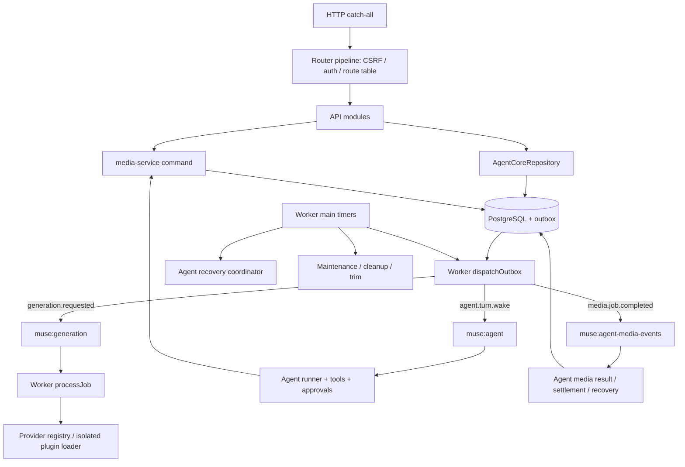

# 后端架构与核心调用链

## 审计范围与基线

- 分支：`dev`，审计启动时 HEAD `308ccca`（相对 `origin/dev` ahead 3）。工作区已有大量未提交改动，且审计过程中 Web 文件内容继续变化；本报告以检查时工作区为准，不把其工作区差异混同于提交内容。
- 依据：`AGENTS.md`、`apps/README.md`、API/Worker/Packages README、入口/路由/队列代码、相关 package 导出和近期 `11a78fa`、`f55e9d4`、`6459e7a` 历史。子任务 A–E 并行审计后汇总。
- 未启动服务、数据库、Redis、容器或 Provider；未读取 `.env`、密钥或凭据；未确认部署环境和实际数据库状态。

## 模块职责

| 层 | 实际职责 | 关键位置 |
|---|---|---|
| API HTTP 适配 | Next catch-all 仅委派；router pipeline 做路径匹配、CSRF、actor/admin gate；路由集中静态注册 | `apps/api/app/api/[...path]/route.ts`、`apps/api/src/router/{pipeline,routes,match,guard}.ts` |
| API 业务模块 | Agent、Canvas、生成、上传、编辑、媒体、管理业务校验与适配；调用 packages，不直接执行供应商插件代码 | `apps/api/src/modules/**` |
| Contracts | DTO、错误码、端点与跨端类型 | `packages/contracts/src/**` |
| Domain | 纯领域规则、生成校验、Agent 状态机 | `packages/domain/src/**` |
| Database | PostgreSQL migrations、事务、Repository，含旧 Canvas/生成及新 Agent 持久化 | `packages/database/src/**`、`migrations/` |
| Media service | API/Worker 共享生成准备、输入锁定和写入命令，是媒体事务收敛点 | `packages/media-service/src/**`、`README.md` |
| Providers | 内置/上传 Provider registry、协议适配、安全 HTTP、凭据和插件 manifest | `packages/providers/src/**` |
| Worker | Outbox 到 Redis Streams、生成消费、Agent turn/media 消费、恢复协调、维护/清理、插件刷新、探针 | `apps/worker/src/{index,queue,jobs,agent,maintenance,plugins}/**` |
| Config / Observability | bootstrap 配置校验及可选 OTLP 初始化 | `packages/config`、`packages/observability` |

依赖方向以 contracts/domain/database/providers/media-service 为共享基础，apps/api 与 apps/worker 做入口和运行时适配。动态 Provider 代码只由 Worker 的 loader 载入；API 处理 catalog/管理，不执行上传插件。

## 主要调用链

1. **普通生成**：`routes.ts` 中的 `POST generations` → `modules/generations/create.ts` → `create-job.ts` → `prepareGeneration` / `createGenerationInTransaction`，将 generation 和 outbox 写入数据库事务；Worker `scheduleMaintenance` 调度 outbox，`muse:generation` consumer 调用 `processJob`，再按固定 revision/输入调用 Provider、处理输出。
2. **新 Agent Core**：`POST agent/*` → Agent handlers/service → `AgentCoreRepository`。消息事务写回执、事件及 wake outbox；Worker Agent consumer 运行 Runner。媒体工具先建立持久 proposal/approval 和预算 reservation，审批后重验绑定并通过同一 `media-service` 创建生成任务；终态事件和 recovery 协调器落工具结果、账本和续跑状态。
3. **旧 Canvas Agent**：`POST/GET canvases/:id/agent/*` → `modules/canvases/agent/*`，使用 `canvas_agent_*` 与 API 侧同步 LLM/SSE；确认后 `submitPending` 调共享生成适配器。它仍是单独公开运行时，不是新 Agent Core 的别名。
4. **图片准备**：当前工作区新增 `POST images/edit/preparations`，只暂存可信图像/遮罩准备身份，不直接生成或收费；其 feature/admission 语义见发现 F-07。

## 边界与架构发现

### A-01 — 两套 Agent Runtime 并存（P1，置信度高；删除风险高）

- 新命名空间 `agent/*`：`apps/api/src/router/routes.ts` → `modules/agent/handlers.ts`/`service.ts` → `AgentCoreRepository` → outbox/Worker durable turn。
- 旧命名空间 `canvases/:id/agent/*`：同路由表 → `modules/canvases/agent/handlers.ts` → `PgAgentStore`、同步 provider chat/SSE。
- 无把旧 session 映射到新 Agent session 的适配层。新旧表、HTTP 合约及事务模型不同。旧路由是公开 API，不能按内部引用数删除；需产品确认兼容期限、客户端与迁移方案。

### A-02 — 旧 Canvas Agent 的 submit 有跨事务边界（P1，置信度高；风险高）

`apps/api/src/modules/canvases/agent/submit.ts` 先 claim，再独立创建 generation，最后 complete；注释明确不是跨事务原子操作，崩溃时依赖 lease/replay 收敛。新 Agent 工具将创建 generation 与 Agent job link 放在共享 SQL transaction。两者语义不同，旧实现不是无效复制品；先建立迁移或兼容决策。

### A-03 — `media-service` 是有效收敛层，须保留（P3，置信度高）

`apps/api/src/modules/generations/create-job.ts` 与 `apps/worker/src/agent/tools/media.ts` 共用 `prepareGeneration` 和 `createGenerationInTransaction`。媒体写入不是两套互不兼容实现；API adapter 与 worker 工具差异属于边界适配。不可为“去重”而将 Actor/HTTP、队列或 DB 事务责任混在一起。

### A-04 — Outbox 与 Provider 隔离链路是有效基础设施（P3，置信度高）

`apps/worker/src/queue/outbox-routing.ts` 明确把生成、Agent wake、媒体完成分流到各自 stream；generation consumer 与 Agent consumers 各自负责 ack/reclaim/recovery。Provider registry / Worker loader / availability gate 形成明确插件信任边界。未发现应整体删除的重复队列或插件入口。

### A-05 — 数据保留、账户清理及镜像问题见交叉审计

详细证据见 `findings.md`：新 Agent 持久数据未纳入用户删除流、Agent streams 缺仓库内 retention 路径、Web Docker workspace manifest 闭包不完整。涉及数据和运行维护策略，不在本轮高风险直接更改范围内。

## 审计限制

本报告反映静态代码结构，不等同运行时、部署或真实 DB/Redis 验证。迁移 ledger、生产 schema、开关、外部运维 override、消费者组状态、真实客户端流量均未核实。路径/符号细节和修复建议见 `findings.md`；验证情况见 `validation.md`。