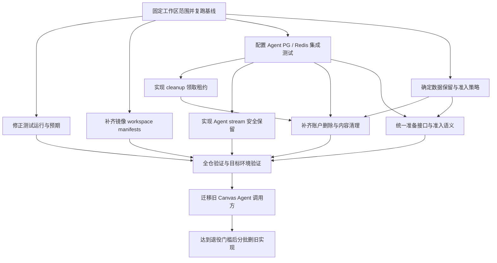

# 后端重构审计：推荐实施方案

> 实施更新（2026-11-18）：用户要求移除旧 CanvasAgent 后，进一步授权“其余按照你的推荐完成”。旧代码与公开入口已退役，继续维护旧运行时/先迁移再删除的原建议已被该决定替代。R-01–R-07 的本地代码、回归与审查现已落实；真实 CI/镜像验收及最终内容擦除政策仍未完成。历史迁移和数据保留，详见 `canvas-agent-removal.md`；最新状态与证据见 `implementation.md`。

## 1. 推荐结论

建议继续沿用现有模块化后端，以 **统一媒体命令、一个目标 Agent 执行内核、可验证的持久化恢复流程** 为演进方向。实施顺序为：**补齐验证 → 修复数据与并发问题 → 统一准入策略 → 按使用证据退役旧架构**。

继续保留 `media-service`、Outbox、独立事件通道、Provider registry 与 Worker 加载边界。旧 CanvasAgent 按用户指令直接退役代码与公开入口；历史数据/迁移和账户清理责任保留，不自动迁移旧会话。当前没有必要另引消息中间件、重写 Repository 或拆出新的微服务。

以下章节保留原推荐顺序、职责与验收标准，不能用建议文字代替执行证据。当前实现和最新验证以 `implementation.md` 为准；原审计快照见 `architecture.md`、`findings.md`、`cleanup.md`、`validation.md`。原来的 Web 两项失败已不再代表当前工作区。

| 推荐项 | 当前状态 | 尚余边界 |
|---|---|---|
| R-01 测试入口 | Web TS loader 与 lockfile 完成，最终 Web 185 项通过 | 并行侧栏/测试更新已保留 |
| R-02 镜像输入 | 补 manifest、最终 WORKDIR 校验、ignore 路径触发回归完成 | clean-context 实际镜像构建未执行 |
| R-03 Agent CI | 五套隔离 fixture 与严格防空跑入口完成 | CI 尚未推送/触发；本地 5 skip 不是集成通过 |
| R-04 cleanup 租约 | 追加 0046、原子 claim/fencing/退避、Worker 预检完成 | 真实 PG 验证和受控迁移；先停旧 Worker |
| R-05 账户删除 | 取消意图、等待收敛及显式政策阻塞完成 | 最终 Agent 内容擦除政策与执行未确定 |
| R-06 Stream 保留 | 默认关闭、安全边界、有界元数据/批次、独立维护和指标完成 | 真实 Redis 验证与保留窗口未确定 |
| R-07 准备授权 | 共享契约、actor admission、可信活跃轮次证明及 Compose 透传完成 | 目标环境行为验收未执行 |

修订后全仓 1,652 项、额外 tooling 17 项通过，typecheck/lint/build 退出 0；未提交、推送或部署。

## 2. 实施顺序与依赖

镜像、测试基线、集成测试配置和策略确认可以并行推进。账户内容清理依赖数据策略与真实数据库测试，并建议建立在可靠任务领取之上。旧系统退役是最后阶段，不应阻塞前面的可靠性修复。

## 3. 第一阶段：建立可依赖的验证与交付路径

### R-01：修复测试基线，保证故障可归因

**关联**：F-12。**建议优先级**：立即；与后端工作并行。

- 实施前记录具体 commit、用户工作区补丁范围与验证命令；避免代码持续变化时把不同快照的结果合并成一个基线。
- SessionSidebar 失败先判断当前组件交互是否是已接受行为，再修改实现或测试。验收应围绕删除、置顶、重命名、清空确认的实际行为，不以恢复旧 DOM 结构或放松断言为目标。
- 附件测试需先在项目标准 Node 版本复现 `ERR_MODULE_NOT_FOUND`。当前 Web 测试直接由 Node 加载 `.mjs`，该文件再引用 TypeScript，最终进入 contracts 的无扩展名导出；推荐在测试边界统一使用能解析 workspace TypeScript 的既有工具链，避免为测试去改浏览器生产导入或复制常量。若需新增 Web 开发依赖，须同步 lockfile。
- 本地与 CI 采用仓库明确的 Node/pnpm 版本，并区分单元、集成和 E2E 命令。

**验收**：两个失败场景分别复现后通过；全仓测试不靠删除用例、跳过或缩小 glob 获得绿色结果。保留实际执行数量与 skip 清单。

### R-02：补齐镜像构建输入

**关联**：F-02。**建议优先级**：立即。

- 在 Web Dockerfile 的 workspace install 之前补齐 `packages/observability/package.json`，与 API/Worker 构建输入保持一致。
- 先做这项局部修复，暂不重构所有 Dockerfile，也不移除 API/Worker manifests 来绕过依赖解析。
- 增加轻量结构校验，检查各 Dockerfile 安装前复制的 workspace manifest 是否满足已复制应用的 `workspace:*` 依赖。
- 在 CI 或获准的构建环境运行干净上下文镜像构建；本地 `next build` 不能替代 Docker install 验证。

**验收**：API、Web、Worker 的 frozen-lockfile install 与镜像构建通过；PR 构建不推送镜像，不改生产运行参数。

### R-03：让现有 Agent 集成测试真正执行

**关联**：F-06。**建议优先级**：立即，作为后续数据修复前置条件。

- 优先复用现有 backend reliability CI 的 PostgreSQL/Redis 设施，按独立步骤执行 Agent runtime、recovery、media terminal、streams 测试；必要时拆独立 job 以避免超时或互相干扰。
- 只注入测试读取的专用 `MUSECANVAS_AGENT_*` 环境变量，保留测试内对 loopback、fixture 用户、独立数据库及清理的约束。不同测试隔离数据库与 Redis key/DB；不连接业务数据库。
- 扩大 workflow 路径过滤，覆盖对应 Agent 集成测试及其 contracts/domain/provider/worker 实际依赖。修正只改 `agent-*-pg.test.ts` 却不触发 fixture job 的缺口。
- 在期望具备 fixture 的 job 中，缺少 URL 或目标测试全部 skip 应导致明确失败；无服务 job 仍允许有说明的 skip。
- 新增任务领取、账户删除、stream 保留测试沿用此设施，不引入另一套测试基础设施。

**验收**：CI 日志明确显示这些测试实际运行；并发领取、旧 lease fencing、事务回滚、重复投递、结算幂等有真实 PG/Redis 证据。

## 4. 第二阶段：优先修复数据与并发风险

### R-04：为 cleanup 建立持久领取协议

**关联**：F-05。**建议优先级**：高。

推荐采用现有 Outbox 风格的 **短事务原子领取 + claim token + 数据库时钟租约 + 有界续租/重试**。

- 对 `deletion_jobs` 和 `asset_deletion_jobs` 追加必要的租约字段与恢复查询索引；通过新迁移扩展，保留历史迁移。
- 领取语句原子写入 token/到期时间；完成、失败、续租必须校验 token 与租约状态。
- 对象存储 I/O 放在事务外；不要在等待网络时一直持有数据库行锁。
- 旧 worker 租约丢失后必须停止后续步骤，不能更新替代 worker 的进度。对象存储删除本身仍需幂等；数据库 fencing 不能保证外部删除请求恰好执行一次。
- 使用批次上限、重试退避与可观测的任务进度；先解决领取协议，不顺带重写整个 maintenance 模块。

**验收**：两个 Worker 并发领取不重叠；崩溃/过期后可恢复；旧 token 无权完成新租约；重复对象删除可安全重试；调度与正常 generation 不被长时间阻塞。

### R-05：补齐账户删除的 Agent 内容处理

**关联**：F-01。**建议优先级**：高；数据策略先确定，实现紧随集成测试和领取协议。

推荐为账户删除定义明确的完成条件：**用户不能继续访问或产生新工作，已产生的外部效果已被记录和妥善收敛，需擦除的内容与对象都已处理，保留记录符合已确定政策**。不能仅完成旧 Canvas 表清理就标记整个任务完成。

先形成一份数据处理矩阵：

| 数据类别 | 推荐方向 | 需确认的边界 |
|---|---|---|
| 用户消息、工具参数/结果、事件 payload、checkpoint、turn 快照 | 列举所有内容副本及对象引用；待任务收敛后按策略擦除 | 不漏 JSON/Outbox 中的内容副本；只处理目标 owner |
| 用户私有 Agent definition instructions | 纳入用户内容策略，单独设计受控清理方式 | `owner_id IS NULL` 的系统定义与其他用户/会话引用必须保护 |
| reservation、usage、审计与幂等记录 | 保留满足恢复与审计所必需的最少元数据，内容字段单独评估 | 保留期限、可识别信息及外键依赖须先确定 |
| legacy links | 将旧/新会话映射纳入依赖图和清理顺序 | 不为绕过 FK 而关闭约束或无条件 cascade |

实施要点：

1. 先阻止新 admission，取消或等待已有 turn/media 的终态与账本收敛；不得仅删除 job 链接，让外部已执行工作成为不可追踪效果。
2. 枚举外键、不可变触发器和共享定义的引用范围。`agent_definitions` 当前不允许任意 UPDATE/DELETE，不能在 cleanup 里直接覆盖 instructions；若政策要求擦除，需单独设计并评审追加迁移和受限清理能力。
3. 仅在明确 FK 顺序与保留政策后确定逐表擦除方式，兼顾 active-turn 指针、legacy links、账本、Outbox 和用户独立定义；不采用整个 `agent_*` 命名空间统一删除。
4. 清理分批、可重入、有进度；任何待处理内容或需收敛工作存在时，不能设置 `deletion_jobs.completed_at`。

**验收**：真实 PG 用例覆盖无 Agent 数据、旧 Canvas 数据、新 Agent 数据、legacy links、共享/私有 definition、活动 turn、已提交媒体、故障恢复和重复执行；完成标记与数据处理一致，其他用户与系统共享定义不受影响。

**执行边界**：代码/追加迁移可评审；真实内容擦除不可通过代码回滚恢复。实际数据清理须在明确保留政策、范围和恢复条件后另行授权。

### R-06：给两个 Agent Streams 增加受保护的保留清理

**关联**：F-04。**建议优先级**：高。

- 复用现有 generation stream 的保守思路，为两个 Agent stream 明确各自 stream/group、retention window、batch size 和开关，不默认沿用未经确认的时长。
- 删除边界同时受保留窗口、group 已投递位置与最老 pending 限制；保留尚未投递、未 ACK、窗口内以及恢复仍依赖的记录。
- 对多个 group，首批推荐遇到未知 group 就停止修剪并报告，后续确有需要再实现所有 group 的共同安全边界。
- 明确 Redis 传输记录与 DB durable item/event 的不同生命周期。只有证明 DB/Outbox 恢复与重放机制满足需求后，才能确定 stream 窗口。
- 补充 stream 长度、pending 数、最老 pending 年龄、修剪量与跳过原因指标；告警阈值根据测试环境和实际流量确定。

**验收**：真实 Redis 测试覆盖 pending、未读、年轻记录、未知 group、重复执行和大 stream 有界批处理；开关关闭后不再删记录，消费/恢复无丢失。

## 5. 第三阶段：统一准入与接口契约

### R-07：以“新工作准入、已有工作可排空”统一 Agent 策略

**关联**：F-03、F-07、F-08。

推荐明确三个独立职责：

- `AGENT_CORE_ENABLED`：命名空间对外是否可用。
- `AGENT_CORE_ADMISSION_READY` 与 actor rollout：是否接受新工作。
- 已受理工作：读取、控制、恢复和结算继续遵循其既有状态与权限。

部署配置建议支持可选透传，但默认维持关闭。首次启用推荐先用明确白名单和 `AGENT_ADMISSION_PERCENT=0`，验证后逐步放量；注意当前实现中白名单可独立于百分比允许用户，不应把 0% 误认为所有用户都被拒绝。

暂停新增工作时推荐先关闭 admission，保持已启用 namespace 可用，使现有会话仍可读/控制；直接关闭 namespace 会令现有 HTTP 控制也返回 404。Worker 已受理任务的 recovery/settlement 不应随 admission 停止。

图片准备接口的目标策略建议为：**为新工作准备资源时遵循 actor admission；为已受理工作准备资源时，以可验证的 owner/session/turn 归属和状态授权，不能仅靠全局开关**。该目标可能需要扩展契约，须先在 contracts/OpenAPI 明确字段、旧客户端行为与过渡期，再改实现；不要简单给所有准备请求加同一个 rollout 检查而误伤已准入工作的排空，也不要保留无会话证明的无限期例外。

**验收**：覆盖 namespace 关闭、全局启用但 admission 关闭、白名单允许、百分比准入、无权限/跨 owner 会话、旧会话排空、准备过期、批准后输入重验；路由、DTO、OpenAPI 和前后端错误处理同步。

## 6. 第四阶段：逐步退役旧 Canvas Agent

本节原先建议兼容迁移后再删除，现已被用户明确要求的代码退役授权替代。下面保留原门槛供历史追溯，不作为当前待执行迁移计划；实际范围见 `canvas-agent-removal.md`，旧会话不自动转换。

1. 盘点旧公开端点、客户端版本、管理配置、脚本、数据关联、请求回放和线上调用；“前端暂时不显示”不能代替无使用证据。
2. 建立能力对照，特别核对 scene operations/apply、确认提交、输入冻结、历史会话读取与恢复；仅媒体生成都进入 media-service 不代表新内核已替代 Canvas 专属能力。
3. 按客户端/会话迁移新请求，历史会话按原 engine 继续处理和排空。不要在重试时把同一请求重新路由到另一 engine，破坏既有 idempotency/digest 绑定。
4. 新请求停止进入旧实现后，旧读/控制/恢复接口按兼容期限继续服务。兼容适配若确有必要，应有清晰退出条件，避免永久增加第三套执行逻辑。
5. 最后分批删除旧内部实现、冗余导出和依赖；公开接口移除与数据库结构退役分别审查，不与代码清理捆绑；历史迁移仍保留。

**退役门槛**：目标能力全部有行为证据；旧入口在约定观察窗口内无新增调用；旧活跃任务清零；历史数据访问/导出策略明确；外部客户端兼容决定已批准；新链路集成和目标场景验证通过。

## 7. 推荐交付拆分与 Agent 分工

下表保留原变更单和责任依赖划分；当前完成状态以文首表及 `implementation.md` 为准。

| 变更单 | 责任方向 | 依赖 | 核心验收 |
|---|---|---|---|
| T-01 测试运行与侧栏回归 | 前端 / QA | 固定基线 | 当前两项失败有根因和有效回归 |
| T-02 Docker manifest 缺件 | 基础设施 | 无 | 干净上下文镜像构建 |
| T-03 Agent 集成测试 CI | QA / 基础设施 | 无 | PG/Redis 用例实际执行，必需 fixture 不静默 skip |
| T-04 cleanup 任务租约 | Database / Worker | T-03 | 并发领取、fencing、恢复 |
| T-05 Agent 账户内容清理 | Database / Worker / Reviewer | 数据策略、T-03、T-04 | 擦除范围、共享数据保护、完成条件 |
| T-06 Agent stream 保留 | Worker / QA | 保留策略、T-03 | 无误删 pending/未读/恢复数据 |
| T-07 准入与准备接口契约 | Contracts / API / Web | 准入策略；contracts 先行 | 新 admission 与旧工作排空、接口兼容 |
| T-08 旧 Agent 迁移与删除 | 架构 / API / Worker / QA | 能力对照及前面关键验证 | 满足明确退役门槛 |

T-01/T-02/T-03 和策略调查并行。T-04/T-06 可在不共享源文件的前提下并行；maintenance 等共享文件由单一负责人合并。T-05 与 T-04 如果共用 maintenance 文件，应按顺序执行。主 Agent 负责契约裁决、结果合并和全局验证；Reviewer 对涉及内容擦除、lease fencing、外部效果和公开接口的变更独立审查。

## 8. 发布与验收门槛

每个变更单先定向验证，再运行项目标准 typecheck/lint/test/build；构建与类型检查避免同时写同一应用的 `.next` 产物。单元、真实数据库/Redis、镜像和场景验证分别记录，未执行项不写通过。

进入目标环境验证前，确认目标环境、镜像 digest、schema 兼容与恢复方式。数据库变更优先采用追加字段/索引的扩展阶段，避免新旧二进制混跑时互不兼容。镜像构建发布、远端部署、实际内容删除、公开 API 退役分别按其授权范围执行。

建议分三道验收门：

- **G1 可验证、可构建**：T-01/T-02/T-03 完成；全仓检查通过，预期 PG/Redis 测试实际运行，干净镜像构建通过。
- **G2 可靠且策略一致**：T-04/T-05/T-06/T-07 完成；多 Worker 故障恢复、账户内容处理、stream 保留、准入与排空场景有证据。
- **G3 可以删旧实现**：目标能力完成、客户端迁移及历史任务排空满足门槛，再执行 T-08 的退役与清理。

## 9. 开始实施前需要明确的决策

| 决策 | 本方案建议 | 决策负责人 |
|---|---|---|
| 目标 Agent 内核 | 新 Agent Core；旧 CanvasAgent 代码已按指令退役，历史数据保留且不自动迁移 | 用户已明确；见退役记录 |
| 内容保留与删除 | 用户内容、共享定义、最小审计/账本元数据分别制定规则 | 产品 / 数据负责人 |
| 初次上线准入 | 默认关闭，明确白名单起步，小比例放量；已有工作可排空 | 产品 / 运维 |
| 准备接口授权 | 新工作受 admission，已受理工作基于可信会话归属授权 | 产品 / API 负责人 |
| Stream 保留窗口 | 用恢复/重放需求及实际流量定值，先采用保守安全边界 | Worker / 运维 |

本地代码阶段已实施并独立复核，后续重点是执行隔离 CI/镜像验收、明确内容保留与 Stream 窗口，以及按授权进行目标环境迁移和验证。代码退役不等于历史数据删除、旧流量排空或生产环境已升级。